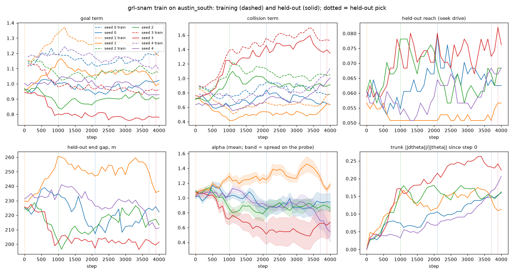

# Does base GRL-SNAM's policy learn? The learning check for `coef_sdf`, and E1 (planted dissipation)

Measured 2026-11-13 on `feat/learning-proof-base` (off `main` at dbf1603). Every number below has
its file in [`learning-validation/`](learning-validation/) and its command in §7.

## 0. The answer

**A null, and on held-out scenes a negative.**

- **The published policy is an untrained net.** `grl-snam-weights`' `coef_sdf.pt` is
  `grl-snam train` at seed 0 for 200 steps on the CPU, reproduced here bit for bit. On every
  scorer it is indistinguishable from its own step-0 net and from a constant net, for example
  Austin reach −0.2 points [−0.5, +0.2] against untrained.
- **The retrain does not descend its own loss.** Five seeds of 4000 steps each:
  - every optimizer step clipped (the pre-clip gradient norm runs from 7 to 7·10¹³);
  - three seeds end with a higher training loss than they started with;
  - on held-out pairs, the held-out picks' training loss is *higher* than the untrained net's:
    +0.75 [+0.25, +1.35].
- **The task-metric gains on Austin are a mean shift, not learning.**
  - The held-out picks reach more held-out Austin pairs than the untrained net:
    +0.8 points [+0.2, +1.6] on the policy's own plant, and +2.2 [+0.9, +3.8] on libcvc's
    navigator (`sim_world`).
  - They pay with clearance: −1.8 m [−2.6, −0.9].
  - A constant net at each pick's own mean coefficients does just as well: −0.3 [−0.8, +0.2] and
    +0.0 [−0.9, +0.9]. Training moved the mean of α (the wall barrier's gain) down. It did not
    learn to use what the net sees.
- **On held-out scenes it is worse.** On eight procedural city scenes the picks reach fewer goals
  than the untrained net, −2.7 points [−5.5, −0.2]. libcvc's `sim_world` gives the same reach set
  as the torch drive.
- **E1 stops at its ceiling.** The best scalar damping per region, fitted straight to the
  generator's windows through the trainer's own surrogate, is 93–97% below the planted
  `γ/M_o`. Pinning the true γ makes that fit's loss 4.9–11× worse. The surrogate cannot see the
  planted latent, so no net trained through it can.
- **The one learner here that beats a constant is coef-train's bicycle path** (§3.8), a different
  trainer.
  - On held-out draws of its own training city it penetrates less than a constant at its own mean
    coefficients: −0.40 [−0.86, −0.03] (blind) and −0.46 [−0.91, −0.11] (μ).
  - Its reach gain over the untrained seed (+3.2) is the mean's.

Do not republish `grl-snam-weights` on these runs: no arm is better than what ships, and what ships
is the untrained net.

## 1. What was asked

The question (2026-11-10): do the learners learn, or accumulate noise? "Proved" means three
things on held-out data, each against an untrained (seed-init) arm and a constant arm:

1. the per-term losses;
2. the task metric, with paired-seed confidence intervals;
3. the recovery error of a planted latent.

A checkpoint is never selected on training loss alone.

This note runs that check on base GRL-SNAM's public policy, the self-supervised SDF `CoefMLP`
behind `grl-snam-weights`' `coef_sdf.pt` (`grl-snam train`, `grl_snam/tools/train.py`), which the
GRL-SNAM demos drive. E1 plants a latent (a damping that changes with position) in the stagewise
generator and asks whether `train_coef_energy` recovers it.

## 2. What was run

### 2.1 Code and machine

- **Code** (this branch):
  - `grl-snam train` gains #165's learning instruments: `--history`, `--checkpoint-every`, and the
    held-out split `--val-frac`, which keeps `<out>.best_heldout.pt`.
  - `grl_snam/tools/sdf_eval.py`: the held-out split, held-out pairs, the objective's terms and
    the seek drive.
  - E1's generator flag, the checkpoint logging and `train_coef_energy --planted`.
  - The scripts in `experiments/learning_proof/`.
- **Machine:** one Linux workstation (32 cores, GTX 1650).
  - **Training ran on the CPU, one thread per seed, by measurement.** A step costs 75 ms on one
    core and 176 ms on the GTX 1650. A batch of 128 through a 28-step rollout is launch-bound on
    the GPU.
  - The published weights were trained on the CPU too. A CUDA run of the same seed gives
    different weights (max |Δw| 0.013), so only the CPU reproduces them.
- **Python:** torch 2.13 (cu130) for training. The `grl-snam-cp312` cvcpkg closure (torch 2.8
  CPU, pycvc 3.7.13+cvc.2) for the native scorers.
- **Scene:** the `austin_south` SDF (`cy-pca/scene-austin-south`, `nav_sdf.npz`: 1024², ±1500 m,
  1 normalized unit = 300 m).

### 2.2 Provenance: the published policy is a 200-step CPU run

`train_sdf(nav_sdf.npz, steps=200, seed=0, device="cpu")` writes a state dict equal, tensor for
tensor, to the published `coef_sdf.pt` (sha256 `afb691c1…`).

- With `--history` and `--checkpoint-every` on, the weights are the same again: the instruments
  observe and do not change the run.
- At step 200 its coefficients on Austin are (α, β, γ) = (1.08, 3.06, 3.97), against
  (1.01–1.09, 2.93–3.17, 3.89–4.09) for the five seeds' untrained nets.

### 2.3 The retrain

- **Recipe:** `grl-snam train`'s own (batch 128, lr 3·10⁻⁴, horizon 28, `nsub` 1, goals 1–2
  units away). Loss = goal + 3·col + 0.1·reg, unchanged.
- **Seeds:** 0–4.
- **Budget: 4000 steps.** That is 20× the published 200, and 2.7× the CLI default of 1500.
  - It costs ~7.5 min a seed on one core (112 ms a step with the instruments).
  - With a checkpoint every 100 steps (41 in all), the held-out curve shows any plateau or
    divergence well past the default.
  - The held-out pick covers the case where later is worse.
  - Seen afterwards: the curves stop trending by ~1000 steps and wander from there (§3.1). A
    longer budget would not change the verdict while every step clips (§3.2).
- **Held-out split** (`--val-frac 0.25 --val-seed 0`):
  - 16 of 64 blocks of 375 m are held out: blocks 0, 2, 4, 9, 14, 16, 26, 30, 31, 37, 38, 41, 46,
    47, 54 and 61.
  - That is 109,868 of the 399,238 free start points. Training starts only outside them.
  - Each checkpoint scores 512 fixed pairs started inside them (`--val-pairs 512`, seed 0): the
    objective's terms, and the seek drive (200 ticks, arrival within 15 m).
  - The pick is the checkpoint with the highest held-out reach, step 0 included.

### 2.4 Arms

| arm | what | per seed |
|---|---|---|
| `published` | `grl-snam-weights` `coef_sdf.pt` | — |
| `trained` | the held-out pick `coef_sdf.best_heldout.pt`: steps 2100, 0, 1000, 3900, 3700 | yes |
| `untrained` | the run's step 0, `coef_sdf.step000000.pt` | yes |
| `final` | the run's step 4000, no pick (what the pick bought) | yes |
| `constant` | output layer zeroed, each coefficient the published policy's mean on the Austin test drive: (1.080, 3.058, 3.974) | — |
| `constant_trained` | the same, at each pick's own mean on that drive | yes |

Seed 1's pick is step 0: no checkpoint beat its untrained net on the pick pairs, so its trained
arm *is* its untrained arm.

### 2.5 Scorers and statistics

- **Austin, seek drive** (`sdf_eval.seek_drive`):
  - 1024 test pairs started in the held-out blocks, drawn with seed 777, so the pick's pairs are
    not reused.
  - The point plant the policy trained on, at its inference settings (`nsub` 3).
  - The deployed navigator's carrot, without its wall-follow escape: this scores the policy, not
    the escape machinery.
  - 200 ticks; arrival within 15 m; penetration = clearance below −0.5 rr.
- **Austin, `sim_world`:** the same 1024 pairs as agents of one libcvc `sim_world` per arm.
  - It drives each arm's exported `.cvcnav` on nav's kinematic bicycle, with the map known.
  - This is the deployed navigator (carrot FSM, wall-follow escape, park at arrival), as
    `grl-snam capture --plant kinematic` drives it. 600 ticks.
- **City:** `scorecard_eval`'s corpus, eight procedural city scenes (seeds 0–7) × 64 agents.
  - The vectorized Swarm, and the same scenes on libcvc's `sim_world`
    (`nav_native.sim_world_from_swarm`).
  - Geometry the policy never saw, in another frame. One unit is one agent.
- **Statistics:** each comparison is paired by unit.
  - The 95% CI is a two-level percentile bootstrap (10,000 draws), resampling the training seeds
    and the units, so it carries training-seed variance.
  - Path length and time to goal are compared only on units both arms reached.
  - `*` marks a CI that excludes 0.

## 3. Results

### 3.1 What training moved: the held-out curves



| seed | pick | train loss, first → last 100 steps | held-out loss, step 0 → pick → 4000 | held-out reach %, step 0 → pick → 4000 | held-out end gap m, step 0 → pick → 4000 | α, step 0 → pick | trunk ‖Δθ‖/‖θ‖ at 4000 |
|---|---|---|---|---|---|---|---|
| 0 | 2100 | 3.79 → 3.57 | 3.12 → 3.45 → 2.95 | 6.1 → 8.0 → 6.2 | 224 → 207 → 222 | 1.02 → 0.85 | 0.160 |
| 1 | 0 | 3.71 → 3.53 | 3.13 → 3.13 → 2.92 | 5.7 → 5.7 → 5.7 | 230 → 230 → 237 | 1.04 → 1.04 | 0.114 |
| 2 | 1000 | 3.74 → 4.25 | 3.10 → 4.01 → 3.66 | 6.1 → 7.8 → 6.8 | 226 → 202 → 213 | 1.10 → 0.85 | 0.163 |
| 3 | 3900 | 3.82 → 5.68 | 3.23 → 5.14 → 4.96 | 5.9 → 8.2 → 7.6 | 226 → 199 → 202 | 1.08 → 0.63 | 0.224 |
| 4 | 3700 | 3.53 → 4.56 | 2.91 → 3.69 → 3.98 | 6.1 → 6.8 → 6.8 | 231 → 213 → 211 | 1.03 → 0.69 | 0.206 |

- **No seed improves the held-out objective and the held-out task together.**
  - Seeds 0 and 1 end with a lower held-out loss and the same reach.
  - Seeds 2–4 gain reach and end gap as their held-out (and training) loss climbs. The goal term
    falls, the collision term rises more.
  - The pick on reach chooses checkpoints whose held-out loss is above step 0's.
- **The seeds go different ways.** α rises for seed 1 and falls to 0.63 for seed 3. The weights
  keep moving (trunk ‖Δθ‖/‖θ‖ 0.11–0.22).
- **The held-out terms sit below the training ones** (goal 0.95 against 1.15 at step 0). Held-out
  goals are in free space, while training goals may fall inside buildings. There is no overfitting
  gap to read: nothing was fitted that generalizes.

Per-seed tables every 100 steps: `learning_curves.py` (§7); all numbers in `curves.json`.

### 3.2 The gradient: every step clips

On all five seeds, 100% of the optimizer steps had a pre-clip gradient norm above the clip (5.0).

- Over seed 0's 4000 steps: min 14, median 6.5·10⁴, 90th percentile 1.4·10⁷, max 2.0·10¹².
- Over all five seeds: min 7, max 7·10¹³; the per-seed medians run from 4.3·10⁴ to 3.4·10⁵.
- Adam therefore follows the direction of whichever samples explode on a step, not the batch's
  objective. That fits training that does not lower its own loss.
- **The likely source is the IPC barrier.** `sdf_nav._ipc_dbdd` grows as `d_hat²/d` as clearance
  `d → 0`. The training rollout is `nsub = 1`, so an agent can step to the wall in one step
  (`vmax·dt` = 0.054 units, against rr = 0.01).

This is the first thing to fix before another retrain (§5).

### 3.3 Held-out per-term losses against untrained and constant

The training objective's terms per test pair (`objective.json`):

| term | published | trained | untrained | final | constant | constant_trained |
|---|---|---|---|---|---|---|
| loss | 3.053 | 3.874 | 3.125 | 3.681 | 3.083 | 3.568 |
| goal | 0.973 | 0.896 | 0.958 | 0.927 | 0.963 | 0.908 |
| col | 0.693 | 0.977 | 0.721 | 0.904 | 0.706 | 0.881 |
| reg | 0.016 | 0.466 | 0.029 | 0.403 | 0.010 | 0.188 |

| term | trained − untrained | trained − constant | trained − published | trained − constant_trained | final − untrained | published − untrained |
|---|---|---|---|---|---|---|
| loss | +0.749 [+0.253, +1.346]* | +0.791 [+0.283, +1.454]* | +0.821 [+0.310, +1.488]* | +0.306 [+0.004, +0.771]* | +0.556 [−0.035, +1.180] | −0.072 [−0.163, +0.028] |
| goal | −0.062 [−0.103, −0.024]* | −0.067 [−0.119, −0.021]* | −0.077 [−0.130, −0.030]* | −0.012 [−0.034, +0.005] | −0.031 [−0.087, +0.026] | +0.015 [−0.006, +0.033] |
| col | +0.256 [+0.091, +0.448]* | +0.271 [+0.101, +0.487]* | +0.284 [+0.114, +0.501]* | +0.096 [+0.001, +0.243]* | +0.183 [−0.022, +0.395] | −0.029 [−0.063, +0.011] |
| reg | +0.437 [+0.043, +1.038]* | +0.455 [+0.046, +1.076]* | +0.449 [+0.040, +1.070]* | +0.278 [+0.018, +0.743]* | +0.373 [+0.093, +0.812]* | −0.013 [−0.033, +0.005] |

**Criterion 1 fails.** On held-out pairs, the trained arm's own objective is worse than
untrained, constant and published. Its goal-term gain (−0.06) is a constant's (−0.01 against
`constant_trained`).

### 3.4 The task metric on Austin's held-out pairs (the policy's plant)

`arms.json`, scorer `austin` (1024 pairs):

| metric | published | trained | untrained | final | constant | constant_trained |
|---|---|---|---|---|---|---|
| reach % | 6.2 [4.8, 7.7] | 7.2 [5.6, 8.9] | 6.4 [5.0, 8.0] | 6.8 [5.2, 8.5] | 6.2 [4.8, 7.8] | 7.5 [5.8, 9.3] |
| penetration ticks | 0.00 | 0.05 [0.00, 0.19] | 0.00 | 0.04 [0.00, 0.22] | 0.00 | 0.00 |
| min clearance m | 11.29 | 9.24 | 11.06 | 10.01 | 11.23 | 9.39 |
| end gap m | 227.0 | 212.1 | 224.7 | 217.2 | 228.3 | 211.3 |

| metric | trained − untrained | trained − constant | trained − published | trained − constant_trained | final − untrained | published − untrained |
|---|---|---|---|---|---|---|
| reach (points) | +0.8 [+0.2, +1.6]* | +1.0 [+0.3, +1.8]* | +1.0 [+0.3, +1.8]* | −0.3 [−0.8, +0.2] | +0.4 [−0.4, +1.3] | −0.2 [−0.5, +0.2] |
| penetration ticks | +0.05 [+0.00, +0.19]* | +0.05 [+0.00, +0.19]* | +0.05 [+0.00, +0.19]* | +0.04 [+0.00, +0.19] | +0.04 [+0.00, +0.22] | 0.00 |
| path m (both arrived) | −3.6 [−7.1, −0.9]* | −4.0 [−7.1, −1.5]* | −3.7 [−7.0, −1.1]* | +1.0 [−1.7, +4.0] | −3.8 [−7.5, −0.7]* | −0.2 [−2.0, +1.4] |
| min clearance m | −1.82 [−2.64, −0.87]* | −1.98 [−2.92, −0.95]* | −2.05 [−2.98, −1.01]* | −0.14 [−0.31, −0.04]* | −1.06 [−2.29, +0.22] | +0.23 [−0.10, +0.50] |
| time to goal s (both arrived) | −0.39 [−0.81, −0.04]* | −0.40 [−0.95, +0.10] | −0.32 [−0.88, +0.18] | +0.06 [−0.08, +0.19] | −0.16 [−0.62, +0.22] | −0.07 [−0.28, +0.10] |
| end gap m | −12.7 [−19.9, −5.6]* | −16.2 [−25.1, −7.8]* | −14.9 [−23.8, −5.9]* | +0.8 [−3.4, +5.5] | −7.6 [−16.7, +1.4] | +2.2 [−1.5, +5.7] |

Per-seed trained − untrained reach: +0.6, 0.0, +1.1, +1.6, +0.7 points.

- **The picks reach more pairs and arrive sooner, by trading clearance.** The barrier is weaker,
  so agents pass closer to buildings and through gaps. Penetration appears where there was none.
- **A constant at the pick's own mean does all of it.** Every task metric against
  `constant_trained` is within its CI of 0, except clearance, where the trained net is 0.14 m
  closer still.
- **Reach is low for every arm** (6–8% within 15 m in 200 ticks). Most 300–600 m pairs have a
  building between start and goal, and a reactive policy without the escape stalls there.

### 3.5 Austin on libcvc's navigator (`sim_world`, kinematic bicycle, 600 ticks)

`arms_austin_native.json`, the same 1024 pairs, every arm's `.cvcnav` driven by the deployed
navigator:

| metric | published | trained | untrained | final | constant | constant_trained |
|---|---|---|---|---|---|---|
| reach % | 12.0 [10.1, 14.1] | 14.2 [11.9, 16.6] | 12.0 [10.0, 14.0] | 13.8 [11.6, 16.2] | 11.7 [9.8, 13.7] | 14.2 [11.8, 16.5] |
| min clearance m | 9.40 | 7.70 | 9.23 | 8.13 | 9.34 | 8.16 |

| metric | trained − untrained | trained − constant | trained − published | trained − constant_trained | final − untrained | published − untrained |
|---|---|---|---|---|---|---|
| reach (points) | +2.2 [+0.9, +3.8]* | +2.5 [+0.9, +4.1]* | +2.2 [+0.7, +3.8]* | +0.0 [−0.9, +0.9] | +1.9 [+0.3, +3.5]* | +0.0 [−0.9, +1.0] |
| penetration ticks | +0.00 [−0.01, +0.02] | +0.01 [+0.00, +0.02]* | +0.01 [−0.00, +0.02] | −0.00 [−0.02, +0.01] | −0.00 [−0.01, +0.01] | −0.00 [−0.02, +0.00] |
| min clearance m | −1.53 [−2.42, −0.65]* | −1.64 [−2.64, −0.73]* | −1.71 [−2.72, −0.79]* | −0.46 [−1.12, +0.05] | −1.10 [−2.20, −0.01]* | +0.17 [−0.16, +0.49] |
| time to goal s (both arrived) | −0.90 [−2.02, −0.03]* | −1.10 [−2.44, +0.11] | −1.23 [−2.45, −0.12]* | +0.52 [−0.12, +1.24] | −0.58 [−1.80, +0.56] | +0.17 [−0.54, +0.92] |
| end gap m | −11.7 [−27.3, +0.6] | −11.9 [−27.7, +1.6] | −1.4 [−15.2, +14.6] | +0.1 [−14.9, +16.1] | −20.6 [−39.3, −4.9]* | −10.3 [−27.9, +3.4] |

- **The deployed navigator doubles everyone's reach** (12–14% against 6–7%): the escape and 600
  ticks do that.
- **The verdict is unchanged.** Trained beats untrained, constant and published, and ties a
  constant at its own mean exactly.
- Path length is left out of the table: `sim_world`'s collector counts the whole run, not
  start-to-arrival. It is in the JSON.

### 3.6 Held-out scenes: the procedural city

`arms.json`, scorers `city` (torch Swarm) and `native` (`sim_world`); 8 scenes × 64 agents:

| metric | published | trained | untrained | final | constant | constant_trained |
|---|---|---|---|---|---|---|
| reach % | 86.9 [84.0, 89.6] | 84.5 [81.2, 87.7] | 87.2 [84.3, 89.9] | 83.2 [78.2, 87.3] | 86.9 [84.0, 89.6] | 86.4 [83.6, 89.1] |
| min clearance m | 7.82 | 7.69 | 7.80 | 7.70 | 7.81 | 7.73 |
| time to goal s | 9.29 | 8.91 | 9.33 | 8.89 | 9.30 | 9.17 |

| metric (torch) | trained − untrained | trained − constant | trained − published | trained − constant_trained | final − untrained | published − untrained |
|---|---|---|---|---|---|---|
| reach (points) | −2.7 [−5.5, −0.2]* | −2.4 [−5.0, −0.1]* | −2.4 [−5.0, +0.0] | −2.0 [−4.5, +0.1] | −4.0 [−8.8, −0.4]* | −0.3 [−1.6, +1.0] |
| min clearance m | −0.11 [−0.16, −0.05]* | −0.12 [−0.17, −0.06]* | −0.13 [−0.18, −0.07]* | −0.04 [−0.07, −0.02]* | −0.10 [−0.17, −0.02]* | +0.02 [+0.01, +0.04]* |
| time to goal s (both arrived) | −0.18 [−0.32, −0.06]* | −0.18 [−0.35, −0.03]* | −0.19 [−0.36, −0.05]* | −0.05 [−0.11, −0.01]* | −0.06 [−0.22, +0.10] | +0.03 [−0.06, +0.10] |
| end gap m | +46.8 [+1.1, +106.2]* | +68.0 [+3.3, +137.7]* | +66.5 [+1.7, +136.5]* | +4.7 [−0.9, +11.9] | +35.1 [+5.3, +67.6]* | −19.7 [−61.5, +2.4] |

Per-seed trained − untrained reach: −4.7, 0.0, 0.0, −5.9, −2.9 points.

- **On held-out geometry the picks are worse.** They arrive a little sooner when they arrive, and
  fail more often. The failures end far away (end gap +47 m).
- **libcvc's `sim_world` gives the same reach set and arrival times** for every arm (its parity
  contract with the Swarm). Its reach rows are identical to these; clearance differs by its own
  definition (`native` in `arms.json`).
- **`scorecard_eval`'s own rows agree** (`scorecard/*.json`, its CLI on each checkpoint):

| arm | arrival | path ratio | penetration % | mean time to goal s |
|---|---|---|---|---|
| published | 0.869 | 1.075 | 0 | 9.29 |
| constant | 0.869 | 1.064 | 0 | 9.30 |
| trained, seeds 0–4 | 0.820, 0.865, 0.869, 0.824, 0.846 | 1.061, 1.070, 1.076, 1.082, 1.043 | 0 | 8.72, 9.26, 9.09, 8.42, 9.03 |
| untrained, seeds 0–4 | 0.867, 0.865, 0.869, 0.883, 0.875 | 1.076, 1.070, 1.067, 1.065, 1.060 | 0 | 9.28, 9.26, 9.25, 9.35, 9.49 |

### 3.7 The heads across scenes

Each head's mean, the spread (standard deviation) of its per-scene means across scenes (Austin: 16
held-out blocks; city: 8 scenes), and the mean within-scene spread. For seeded arms these are
means over the seeds:

| arm | α mean / across / within (Austin) | β (Austin) | γ (Austin) | α (city) | β (city) | γ (city) |
|---|---|---|---|---|---|---|
| published | 1.080 / 0.008 / 0.017 | 3.058 / 0.029 / 0.057 | 3.974 / 0.013 / 0.026 | 1.095 / 0.001 / 0.012 | 3.021 / 0.007 / 0.062 | 4.001 / 0.003 / 0.027 |
| trained | 0.899 / 0.027 / 0.067 | 3.246 / 0.035 / 0.089 | 3.900 / 0.018 / 0.044 | 0.806 / 0.009 / 0.081 | 3.346 / 0.013 / 0.107 | 3.851 / 0.007 / 0.064 |
| untrained | 1.054 / 0.007 / 0.015 | 3.055 / 0.012 / 0.027 | 3.962 / 0.006 / 0.014 | 1.055 / 0.002 / 0.019 | 3.070 / 0.004 / 0.031 | 3.968 / 0.003 / 0.027 |
| final | 0.921 / 0.026 / 0.065 | 3.048 / 0.046 / 0.111 | 3.950 / 0.014 / 0.033 | 0.838 / 0.009 / 0.086 | 3.098 / 0.015 / 0.140 | 3.916 / 0.005 / 0.055 |

(Austin: the per-pair means over the seek drive. City: at each agent's start. The constant arms
have zero spread by construction.)

- **Training widens the heads about 4×.** The net starts to vary α with what it sees.
- **That variation buys nothing.** The trained arm ties or trails `constant_trained` on every
  task metric (§3.4–3.6), and on held-out loss it is worse (+0.31, §3.3).
- **The mean moves much more than the spread.** α's mean falls by 0.16 on Austin and 0.25 on the
  city, 6× and 28× its spread across scenes. That shift is what the gains come from.

### 3.8 coef-train's bicycle path (`coef_eval --compare-mu`)

`coef_eval` fine-tunes a different trainer (`coef_train.train_bicycle`): the kinematic bicycle on
the procedural city with an ice band, with a margin-shortfall loss normalized to O(1), w_coll 3,
for 120 steps. It scores against the untrained seed net.

`coef_eval --compare-mu --seeds 5` (`coef_eval_compare_mu.txt`, one draw of 192 agents):

| arm | reach | penetration | clearance | raw penetration per seed |
|---|---|---|---|---|
| seed (untrained) | 15.1% | 0.54 | 0.335 | |
| blind (5-feature) | 16.5% | 0.22 | 0.581 | 0.0, 0.53, 0.03, 0.0, 0.56 |
| mu-ahead (6-feature) | 16.0% | 0.11 | 0.590 | 0.0, 0.08, 0.46, 0.03, 0.0 |

`experiments/learning_proof/coef_eval_paired.py` (`coef_eval_paired.json`) trains the same arms
over the same 5 seeds, then scores each agent on three draws (192 agents each, seeds 4242–4244).
It adds a constant net at each trained net's own mean coefficients on that drive:

| arm | reach | penetration | clearance | mean (α, β, γ) over the 5 seeds' drives |
|---|---|---|---|---|
| seed (untrained) | 16.5% | 1.04 | 0.338 | (0.99, 3.05, 4.07) |
| blind (5-feature) | 19.7% | 0.49 | 0.571 | α 65–78, β 0.46–13.8, γ 0.024–0.071 |
| its constant_trained | 19.3% | 0.88 | 0.374 | |
| mu-ahead (6-feature) | 19.1% | 0.37 | 0.578 | α 70–88, β 0.45–1.96, γ 0.021–0.051 |
| its constant_trained | 19.0% | 0.84 | 0.376 | |

| arm | metric | trained − seed | trained − constant_trained |
|---|---|---|---|
| blind | reach (points) | +3.2 [+1.4, +5.0]* | +0.4 [−0.7, +1.4] |
| blind | penetration | −0.55 [−1.12, −0.03]* | −0.40 [−0.86, −0.03]* |
| blind | clearance | +0.23 [+0.07, +0.40]* | +0.20 [+0.03, +0.36]* |
| mu-ahead | reach (points) | +2.6 [+0.2, +4.8]* | +0.1 [−1.7, +1.5] |
| mu-ahead | penetration | −0.66 [−1.21, −0.19]* | −0.46 [−0.91, −0.11]* |
| mu-ahead | clearance | +0.24 [+0.10, +0.40]* | +0.20 [+0.06, +0.36]* |

- **This trainer learns something a constant does not**, on held-out draws of the world it trained
  on.
  - It moves the coefficients far from the bias regime: a strong barrier, almost no damping.
  - Its reach gain is the mean's: it ties a constant at its own mean.
  - Its safety gain is not: it penetrates less and keeps more clearance than that constant.
- **The μ feature is a wash, as `coef_eval` says.**
- **What it is not:**
  - It is not `coef_sdf`'s trainer, and not a held-out-scene result: the draws are new, the city
    is the one it trained on.
  - Penetration stays bimodal across seeds (raw column above).

### 3.9 Verdict

| criterion | result |
|---|---|
| 1. held-out per-term losses vs untrained and constant | **fails**: the picks' held-out objective is worse than untrained, constant and published (§3.3) |
| 2. task metric, paired-seed CIs | **null**: on Austin the picks beat untrained/constant/published only as a constant at their own mean does (§3.4, §3.5); on held-out city scenes they are worse (§3.6). (coef-train's bicycle path does beat a constant on safety, on its own city: §3.8) |
| 3. planted latent | **not reached**: E1 stops at the ceiling (§4) |
| selection never on training loss | held, and it mattered: the held-out pick chose checkpoints with a higher held-out loss than step 0, and step 0 on one seed |

## 4. E1, planted dissipation

### 4.1 The exercise

- **Generator** (`scripts/spline_stagewise6.py`):
  - `HyperelasticRingSystem(gamma_o_regions=[(x_lo, x_hi, γ), …])` looks the translational
    damping up at the ring centre's x.
  - The contact friction, a hard-coded 0.1, is now `fric_mu` (default 0.1). The dataset's Case-2
    perturbation already set `fric_mu` and logged it, but the step never read it; now it does.
- **Logging:** `make_checkpoint` (`scripts/stagewise_dataset.py`) logs `gamma_o_true`, the γ the
  step integrated with.
- **Data** (`experiments/learning_proof/e1_generate.py`): two datasets on the same 40 obstacle
  fields (Case 1, seeds 20261113+i), with `fric_mu = 0`.
  - `planted`: γ = 2.5 for x < 4.5 and 6.0 beyond. Truth γ/M_o = 1.667 and 4.0, ratio 2.4.
  - `control`: γ = 4.0 everywhere (truth 2.667 in both regions, ratio 1.0).
  - 37 and 38 of 40 episodes reach the goal.
  - The centre moves at ~0.35 in the low-damping region and ~0.17 in the high one.
- **Trainer:** `train_coef_energy --planted planted.json --val-frac … --w_friction 0`. It logs
  `heldout.planted.<region>.{truth, mean, rel_err, n, truth_logged}` and the ratio:
  - for the untrained net (a new `init` record, and `init.pt`);
  - and for every epoch.
- **Pass:**
  - |γ̂ − γ_r/M_o| / (γ_r/M_o) ≤ 20% in each region;
  - γ̂_hi/γ̂_lo within 15% of 2.4;
  - the control's ratio within 1 ± 0.1;
  - the untrained net fails all three.

### 4.2 The ceiling: the best scalar γ per region, fitted directly

`experiments/learning_proof/e1_ceiling.py` (`e1/ceiling.json`):

- It draws 20,000 windows per dataset with the trainer's own sampler (`ShortRollouts`).
- It keeps those whose centre starts and ends in one region.
- It fits by L-BFGS through the trainer's integrator (`integrate_surrogate_v2`) and loss
  (traj + vel MSE). There are three fits:
  - `shared`: γ per region, one α and one β;
  - `free`: α, β and γ per region;
  - `pinned`: γ fixed at the truth.

| dataset | fit | γ̂ lo (truth) | err | γ̂ hi (truth) | err | ratio (truth) | α, β | loss |
|---|---|---|---|---|---|---|---|---|
| planted | shared | 0.103 (1.667) | 94% | 0.268 (4.0) | 93% | 2.61 (2.4) | 0.003, 0.030 | 1.93e-4 |
| planted | free | 0.174 | 90% | 0.158 | 96% | 0.91 | — | 1.90e-4 |
| planted | pinned | 1.667 | 0 | 4.0 | 0 | 2.4 | 0.043, 0.404 | 9.41e-4 (4.9×) |
| control | shared | 0.077 (2.667) | 97% | 0.101 (2.667) | 96% | 1.31 (1.0) | 0.001, 0.014 | 8.11e-5 |
| control | free | 0.042 | 98% | 0.152 | 94% | 3.61 | — | 8.03e-5 |
| control | pinned | 2.667 | 0 | 2.667 | 0 | 1.0 | 0.050, 0.399 | 9.23e-4 (11.4×) |

Windows in-region: planted 5709 lo / 14208 hi; control 8067 / 11856. The moving windows alone
(|v0| > 0.05) give the same fits to within ~0.01.

- **The ceiling fails all three criteria.** The relative errors are 90–98% against ≤ 20%. The
  planted ratio passes only in the shared fit, and the free fit misses it by 62%. The control's
  ratio is 1.31 or 3.61 against 1 ± 0.1.
- **E1 stops here, as specified.** No net trained through this surrogate can recover what the
  surrogate's own best fit cannot.

### 4.3 Why the surrogate cannot see γ

- **The drive is mis-specified, and that dominates.**
  - The surrogate drives the centre with a goal spring toward the stage exit.
  - The generator drives it with its stage force field (goal, radial, tangential, flow, boundary
    terms, summed over the ring).
  - At cruise, drive and damping cancel, so the centre moves at near-constant velocity.
  - The surrogate cannot reproduce that drive. Its best fit sets every force near zero (α ≈
    0.003, β ≈ 0.03, γ ≈ 0.1–0.27): constant-velocity extrapolation.
  - Any true-sized γ decelerates the centre with nothing to balance it, which is why pinning it
    costs 5–11× in loss.
- **The windows' timing is off (secondary).**
  - A window integrates H steps of `dt' = dt_mult·dt` against a target K = round(H·dt_mult) base
    steps away, so the two durations differ by 4.0% on average (90th percentile 8.4%, max 25%).
  - Its v0 is the forward difference from t0, i.e. the velocity after step t0+1.

### 4.4 Pipeline check of `--planted` (not the E1 test)

To confirm the logging end to end on the real data: one seed, two epochs, on `planted`,
`--val-frac 0.25 --val-samples 1024 --w_friction 0` (`e1/pipeline_history.jsonl`).

| record | γ̂ lo (1.667) | err | γ̂ hi (4.0) | err | ratio (2.4) | γ head spread across held-out episodes |
|---|---|---|---|---|---|---|
| init (untrained) | 0.588 | 65% | 0.622 | 84% | 1.06 | 0.020 |
| epoch 0 | 2.622 | 57% | 2.573 | 36% | 0.98 | 0.063 |
| epoch 1 | 2.328 | 40% | 2.453 | 39% | 1.05 | 0.281 |

- **The untrained net fails all three**, as required of it.
- **Training moves γ̂ to one average value**, with no regional dependence (ratio ≈ 1), as the
  ceiling predicts. The control dataset was not trained.

## 5. What this means

- **There is no evidence that `grl-snam train` learns anything a constant would not.**
  - Its gains on Austin come from lowering one coefficient's mean, paid in clearance.
  - They reverse on held-out scenes.
  - Its own held-out objective gets worse.
- **The published weights are the untrained net.** Keep them. A republish on these runs would
  ship noise.
- **What would give the next retrain a chance:**
  - **Bound the gradient first.**
    - Clamp the barrier's force and derivative, as `train_coef_energy`'s `ipc_piecewise` does
      (`max_grad`), or train with `nsub > 1` so agents cannot step to the wall.
    - Then check that the history's `grad_norm.clipped_frac` falls well below 1.
  - **Train toward the task.**
    - The objective scores the squared distance 28 steps (1.7 s) into a 1–2 unit leg. Arrival
      needs ~60–100 steps, and through buildings it needs the escape.
    - coef-train's bicycle path, with the O(1)-normalized margin-shortfall loss, is the one trainer
      here whose net does better than a constant at its own mean (§3.8). Its clearance term is
      what transfers.
  - **Score every pick against a constant at its own mean**, not only against the untrained net.
    Here that control erased every gain.
  - **Use more seeds and pairs for the pick.** Picks on 512 pairs chose noise-level maxima (6.8–8.2%
    against 5.7–6.1% at step 0). The fresh test pairs show the winner's curse: the picks gained
    +1.3 points on their own pairs and +0.8 on fresh ones.
- **For E1, before training anything:**
  - give the surrogate the generator's own drive (or a drive class that contains it);
  - align the window timing;
  - rerun the ceiling.
  - `--planted`, the generator flag and the logging are in place for that.

## 6. Caveats

- **Austin's held-out blocks are held out from the retrain only.** The published policy trained
  on all of Austin, so its Austin rows are not held out; it ties the untrained net anyway.
- **The city is in another frame.**
  - The policy was trained at 1 unit = 300 m; its `d_hat` and rr are in units.
  - The city scorer applies it to the city's frame, as `scorecard_eval` always has.
  - That makes the city a transfer test, not a second Austin.
- **The torch seek drive has no escape; the `sim_world` scorer has it.** They agree on the
  verdict.
- **Arrival is within 15 m** (`grl-snam capture`'s plant radius), not the navigator's 150 m
  `reach_tol`. On 300–600 m pairs, 150 m would count most stalls as arrivals.
- **The stagewise generator does not repeat bit for bit.** Two runs of the same seed drift apart
  (by 3·10⁻³ in the centre's position within 25 steps), on one thread too.
  - The E1 datasets are the ones generated; regenerating them gives statistically equivalent, not
    identical, episodes.
  - The test of `fric_mu` therefore checks one step's friction force, not a trajectory.
- **`stagewise_dataset.py`'s `main()` writes every episode's checkpoints to one shared file**
  (`<out>/episodes/stagewise_checkpoints.jsonl`), so its manifest's records all read the last
  episode. `e1_generate.py` writes each episode to its own directory. `main()` is unchanged here.
- **Not tested:** the Jolt and dynamic plants, other cities, longer legs.

## 7. Files and commands

### Files (`docs/learning-validation/`)

| file | what |
|---|---|
| `retrain/seed{0..4}.history.jsonl.gz` | the five training histories (`grl_snam.coef_train_history/v1`) |
| `curves.json`, `curves.png` | §3.1, from the histories |
| `objective.json` | §3.3 |
| `arms.json` | §3.4, §3.6, §3.7: scorers `austin`, `city`, `native` |
| `arms_austin_native.json` | §3.5 |
| `scorecard/*.json` | §3.6, `scorecard_eval --json` per checkpoint |
| `coef_eval_compare_mu.txt`, `coef_eval_paired.json` | §3.8 |
| `e1/planted.json`, `e1/control.json` | the planted specs |
| `e1/ceiling.json` | §4.2 |
| `e1/pipeline_history.jsonl` | §4.4 |

The picks' sha256 (not committed; `grl-snam train` on the CPU regenerates them bit for bit):

| seed | sha256 |
|---|---|
| 0 | `a9196234…` |
| 1 | `1b762d9c…` |
| 2 | `64a5dcd8…` |
| 3 | `1e00db26…` |
| 4 | `c9c94838…` |

### Commands

`SDF=<prefix>/share/cvc-scenes/austin_south/nav_sdf.npz` (`cvcpkg install cy-pca/scene-austin-south`),
`PUB=cvcpkg/recipes/grl-snam-weights/payload/coef_sdf.pt`, run from the repository root with
`PYTHONPATH=.`.

```bash
# 2.2: the published policy, reproduced
python -c "from grl_snam.tools.train import train_sdf; train_sdf('$SDF', 'repro.pt', steps=200, seed=0, threads=1, device='cpu')"

# 2.3: the retrain, one seed (s = 0..4), each in its own directory runs/retrain/seed$s
grl-snam train $SDF -o coef_sdf.pt --steps 4000 --seed $s --threads 1 --device cpu \
  --history history.jsonl --checkpoint-every 100 --val-frac 0.25 --val-seed 0 --val-pairs 512 --val-ticks 200

# 3.1
python experiments/learning_proof/learning_curves.py runs/retrain/seed*/history.jsonl --json curves.json --png curves.png

# the claims, on the committed histories (gzipped histories read as they are)
grl-snam learn-report docs/learning-validation/retrain/seed*.history.jsonl.gz
grl-snam ariadne learn docs/learning-validation/retrain/seed*.history.jsonl.gz

# 3.4, 3.6, 3.7 (writes arms.constant.pt / arms.constant_trained<k>.pt beside arms.json)
python experiments/learning_proof/sdf_arms.py --sdf $SDF --runs runs/retrain --published $PUB --out arms.json
python experiments/learning_proof/arms_table.py arms.json

# 3.5 (needs a pycvc with sim_world: the grl-snam-cp312 closure)
python experiments/learning_proof/sdf_arms.py --sdf $SDF --runs runs/retrain --published $PUB \
  --out arms_austin_native.json --no-city --austin-native

# 3.3
python experiments/learning_proof/objective_arms.py --sdf $SDF --runs runs/retrain --published $PUB \
  --constants arms.json --out objective.json

# 3.6, scorecard_eval's own rows (one per checkpoint)
python -m grl_snam.tools.scorecard_eval --checkpoint <arm.pt> --json <arm>.json

# 3.8
python -m grl_snam.tools.coef_eval --compare-mu --seeds 5
python experiments/learning_proof/coef_eval_paired.py --seeds 5 --out coef_eval_paired.json

# 4.1-4.4
python experiments/learning_proof/e1_generate.py --out runs/e1/data --episodes 40 --workers 8
python experiments/learning_proof/e1_ceiling.py runs/e1/data/planted runs/e1/data/control --out ceiling.json
python -m grl_snam.train_coef_energy --root runs/e1/data/planted --epochs 2 --bs 64 --lr 3e-4 --workers 2 \
  --outdir ck --val-frac 0.25 --val-seed 0 --val-samples 1024 --history history.jsonl \
  --planted runs/e1/data/planted/planted.json --w_friction 0
```
