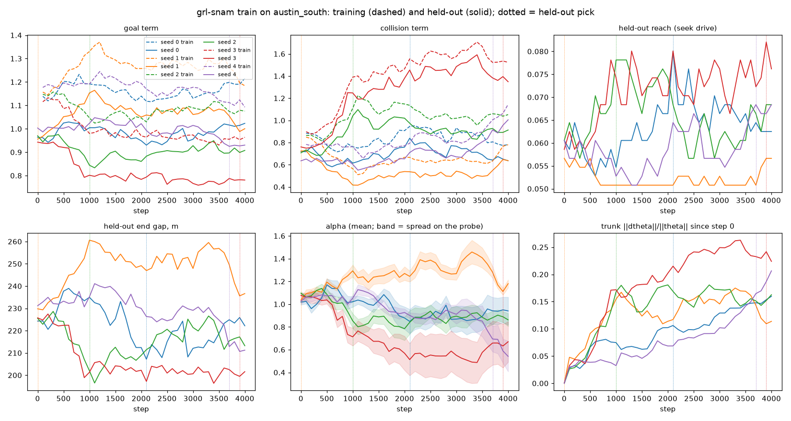
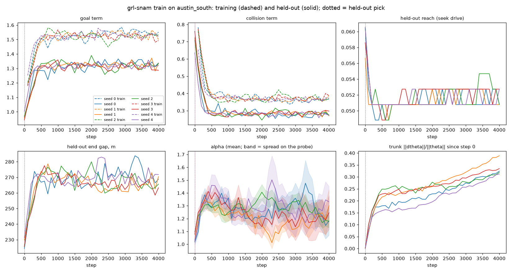
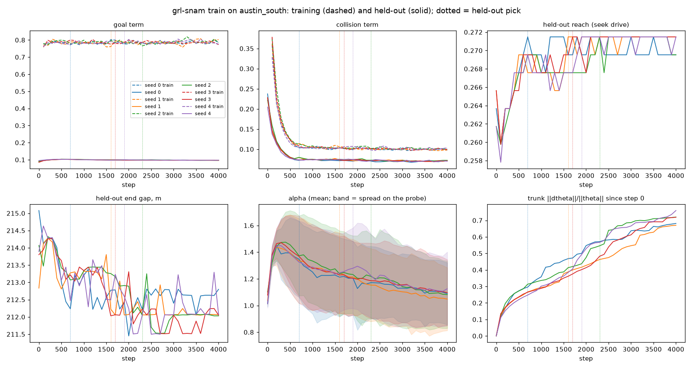

# Does base GRL-SNAM's policy learn? The learning check for `coef_sdf`, and E1 (planted dissipation)

Measured 2026-11-13 on `feat/learning-proof-base` (off `main` at dbf1603). Every number below has
its file in [`learning-validation/`](learning-validation/) and its command in §7.

**§8 (2026-11-14) finds why the retrain diverged, fixes it, and runs the measure again.** §§0–7
describe the trainer before that fix.

**§9 (2026-11-14) finds that the sim was not in world units on Austin (a 270 m/s robot), simulates
it at its real size with an objective that is the task, and runs the measure again.** The held-out
task curve now rises on every seed, by less than the test pairs can resolve.

## 0. The answer

**A null, and on held-out scenes a negative.**

- **The published policy is an untrained net.** `grl-snam-weights`' `coef_sdf.pt` is
  `grl-snam train` at seed 0 for 200 steps on the CPU, reproduced here bit for bit. On every
  scorer it is indistinguishable from its own step-0 net and from a constant net, for example
  Austin reach −0.2 points [−0.5, +0.2] against untrained.
- **The retrain does not descend its own loss.** Five seeds of 4000 steps each:
  - every optimizer step clipped (the pre-clip gradient norm runs from 7 to 7·10¹³);
  - three seeds end with a higher training loss than they started with;
  - on held-out pairs, the held-out picks' training loss is *higher* than the untrained net's:
    +0.75 [+0.25, +1.35].
- **The task-metric gains on Austin are a mean shift, not learning.**
  - The held-out picks reach more held-out Austin pairs than the untrained net:
    +0.8 points [+0.2, +1.6] on the policy's own plant, and +2.2 [+0.9, +3.8] on libcvc's
    navigator (`sim_world`).
  - They pay with clearance: −1.8 m [−2.6, −0.9].
  - A constant net at each pick's own mean coefficients does just as well: −0.3 [−0.8, +0.2] and
    +0.0 [−0.9, +0.9]. Training moved the mean of α (the wall barrier's gain) down. It did not
    learn to use what the net sees.
- **On held-out scenes it is worse.** On eight procedural city scenes the picks reach fewer goals
  than the untrained net, −2.7 points [−5.5, −0.2]. libcvc's `sim_world` gives the same reach set
  as the torch drive.
- **E1 stops at its ceiling.** The best scalar damping per region, fitted straight to the
  generator's windows through the trainer's own surrogate, is 93–97% below the planted
  `γ/M_o`. Pinning the true γ makes that fit's loss 4.9–11× worse. The surrogate cannot see the
  planted latent, so no net trained through it can.
- **The one learner here that beats a constant is coef-train's bicycle path** (§3.8), a different
  trainer.
  - On held-out draws of its own training city it penetrates less than a constant at its own mean
    coefficients: −0.40 [−0.86, −0.03] (blind) and −0.46 [−0.91, −0.11] (μ).
  - Its reach gain over the untrained seed (+3.2) is the mean's.

Do not republish `grl-snam-weights` on these runs: no arm is better than what ships, and what ships
is the untrained net.

## 1. What was asked

The question (2026-11-10): do the learners learn, or accumulate noise? "Proved" means three
things on held-out data, each against an untrained (seed-init) arm and a constant arm:

1. the per-term losses;
2. the task metric, with paired-seed confidence intervals;
3. the recovery error of a planted latent.

A checkpoint is never selected on training loss alone.

This note runs that check on base GRL-SNAM's public policy, the self-supervised SDF `CoefMLP`
behind `grl-snam-weights`' `coef_sdf.pt` (`grl-snam train`, `grl_snam/tools/train.py`), which the
GRL-SNAM demos drive. E1 plants a latent (a damping that changes with position) in the stagewise
generator and asks whether `train_coef_energy` recovers it.

## 2. What was run

### 2.1 Code and machine

- **Code** (this branch):
  - `grl-snam train` gains #165's learning instruments: `--history`, `--checkpoint-every`, and the
    held-out split `--val-frac`, which keeps `<out>.best_heldout.pt`.
  - `grl_snam/tools/sdf_eval.py`: the held-out split, held-out pairs, the objective's terms and
    the seek drive.
  - E1's generator flag, the checkpoint logging and `train_coef_energy --planted`.
  - The scripts in `experiments/learning_proof/`.
- **Machine:** one Linux workstation (32 cores, GTX 1650).
  - **Training ran on the CPU, one thread per seed, by measurement.** A step costs 75 ms on one
    core and 176 ms on the GTX 1650. A batch of 128 through a 28-step rollout is launch-bound on
    the GPU.
  - The published weights were trained on the CPU too. A CUDA run of the same seed gives
    different weights (max |Δw| 0.013), so only the CPU reproduces them.
- **Python:** torch 2.13 (cu130) for training. The `grl-snam-cp312` cvcpkg closure (torch 2.8
  CPU, pycvc 3.7.13+cvc.2) for the native scorers.
- **Scene:** the `austin_south` SDF (`cy-pca/scene-austin-south`, `nav_sdf.npz`: 1024², ±1500 m,
  1 normalized unit = 300 m).

### 2.2 Provenance: the published policy is a 200-step CPU run

`train_sdf(nav_sdf.npz, steps=200, seed=0, device="cpu")` writes a state dict equal, tensor for
tensor, to the published `coef_sdf.pt` (sha256 `afb691c1…`).

- With `--history` and `--checkpoint-every` on, the weights are the same again: the instruments
  observe and do not change the run.
- At step 200 its coefficients on Austin are (α, β, γ) = (1.08, 3.06, 3.97), against
  (1.01–1.09, 2.93–3.17, 3.89–4.09) for the five seeds' untrained nets.

### 2.3 The retrain

- **Recipe:** `grl-snam train`'s own (batch 128, lr 3·10⁻⁴, horizon 28, `nsub` 1, goals 1–2
  units away). Loss = goal + 3·col + 0.1·reg, unchanged.
- **Seeds:** 0–4.
- **Budget: 4000 steps.** That is 20× the published 200, and 2.7× the CLI default of 1500.
  - It costs ~7.5 min a seed on one core (112 ms a step with the instruments).
  - With a checkpoint every 100 steps (41 in all), the held-out curve shows any plateau or
    divergence well past the default.
  - The held-out pick covers the case where later is worse.
  - Seen afterwards: the curves stop trending by ~1000 steps and wander from there (§3.1). A
    longer budget would not change the verdict while every step clips (§3.2).
- **Held-out split** (`--val-frac 0.25 --val-seed 0`):
  - 16 of 64 blocks of 375 m are held out: blocks 0, 2, 4, 9, 14, 16, 26, 30, 31, 37, 38, 41, 46,
    47, 54 and 61.
  - That is 109,868 of the 399,238 free start points. Training starts only outside them.
  - Each checkpoint scores 512 fixed pairs started inside them (`--val-pairs 512`, seed 0): the
    objective's terms, and the seek drive (200 ticks, arrival within 15 m).
  - The pick is the checkpoint with the highest held-out reach, step 0 included.

### 2.4 Arms

| arm | what | per seed |
|---|---|---|
| `published` | `grl-snam-weights` `coef_sdf.pt` | — |
| `trained` | the held-out pick `coef_sdf.best_heldout.pt`: steps 2100, 0, 1000, 3900, 3700 | yes |
| `untrained` | the run's step 0, `coef_sdf.step000000.pt` | yes |
| `final` | the run's step 4000, no pick (what the pick bought) | yes |
| `constant` | output layer zeroed, each coefficient the published policy's mean on the Austin test drive: (1.080, 3.058, 3.974) | — |
| `constant_trained` | the same, at each pick's own mean on that drive | yes |

Seed 1's pick is step 0: no checkpoint beat its untrained net on the pick pairs, so its trained
arm *is* its untrained arm.

### 2.5 Scorers and statistics

- **Austin, seek drive** (`sdf_eval.seek_drive`):
  - 1024 test pairs started in the held-out blocks, drawn with seed 777, so the pick's pairs are
    not reused.
  - The point plant the policy trained on, at its inference settings (`nsub` 3).
  - The deployed navigator's carrot, without its wall-follow escape: this scores the policy, not
    the escape machinery.
  - 200 ticks; arrival within 15 m; penetration = clearance below −0.5 rr.
- **Austin, `sim_world`:** the same 1024 pairs as agents of one libcvc `sim_world` per arm.
  - It drives each arm's exported `.cvcnav` on nav's kinematic bicycle, with the map known.
  - This is the deployed navigator (carrot FSM, wall-follow escape, park at arrival), as
    `grl-snam capture --plant kinematic` drives it. 600 ticks.
- **City:** `scorecard_eval`'s corpus, eight procedural city scenes (seeds 0–7) × 64 agents.
  - The vectorized Swarm, and the same scenes on libcvc's `sim_world`
    (`nav_native.sim_world_from_swarm`).
  - Geometry the policy never saw, in another frame. One unit is one agent.
- **Statistics:** each comparison is paired by unit.
  - The 95% CI is a two-level percentile bootstrap (10,000 draws), resampling the training seeds
    and the units, so it carries training-seed variance.
  - Path length and time to goal are compared only on units both arms reached.
  - `*` marks a CI that excludes 0.

## 3. Results

### 3.1 What training moved: the held-out curves



| seed | pick | train loss, first → last 100 steps | held-out loss, step 0 → pick → 4000 | held-out reach %, step 0 → pick → 4000 | held-out end gap m, step 0 → pick → 4000 | α, step 0 → pick | trunk ‖Δθ‖/‖θ‖ at 4000 |
|---|---|---|---|---|---|---|---|
| 0 | 2100 | 3.79 → 3.57 | 3.12 → 3.45 → 2.95 | 6.1 → 8.0 → 6.2 | 224 → 207 → 222 | 1.02 → 0.85 | 0.160 |
| 1 | 0 | 3.71 → 3.53 | 3.13 → 3.13 → 2.92 | 5.7 → 5.7 → 5.7 | 230 → 230 → 237 | 1.04 → 1.04 | 0.114 |
| 2 | 1000 | 3.74 → 4.25 | 3.10 → 4.01 → 3.66 | 6.1 → 7.8 → 6.8 | 226 → 202 → 213 | 1.10 → 0.85 | 0.163 |
| 3 | 3900 | 3.82 → 5.68 | 3.23 → 5.14 → 4.96 | 5.9 → 8.2 → 7.6 | 226 → 199 → 202 | 1.08 → 0.63 | 0.224 |
| 4 | 3700 | 3.53 → 4.56 | 2.91 → 3.69 → 3.98 | 6.1 → 6.8 → 6.8 | 231 → 213 → 211 | 1.03 → 0.69 | 0.206 |

- **No seed improves the held-out objective and the held-out task together.**
  - Seeds 0 and 1 end with a lower held-out loss and the same reach.
  - Seeds 2–4 gain reach and end gap as their held-out (and training) loss climbs. The goal term
    falls, the collision term rises more.
  - The pick on reach chooses checkpoints whose held-out loss is above step 0's.
- **The seeds go different ways.** α rises for seed 1 and falls to 0.63 for seed 3. The weights
  keep moving (trunk ‖Δθ‖/‖θ‖ 0.11–0.22).
- **The held-out terms sit below the training ones** (goal 0.95 against 1.15 at step 0). Held-out
  goals are in free space, while training goals may fall inside buildings. There is no overfitting
  gap to read: nothing was fitted that generalizes.

Per-seed tables every 100 steps: `learning_curves.py` (§7); all numbers in `curves.json`.

### 3.2 The gradient: every step clips

On all five seeds, 100% of the optimizer steps had a pre-clip gradient norm above the clip (5.0).

- Over seed 0's 4000 steps: min 14, median 6.5·10⁴, 90th percentile 1.4·10⁷, max 2.0·10¹².
- Over all five seeds: min 7, max 7·10¹³; the per-seed medians run from 4.3·10⁴ to 3.4·10⁵.
- Adam therefore follows the direction of whichever samples explode on a step, not the batch's
  objective. That fits training that does not lower its own loss.
- **The likely source is the IPC barrier.** `sdf_nav._ipc_dbdd` grows as `d_hat²/d` as clearance
  `d → 0`. The training rollout is `nsub = 1`, so an agent can step to the wall in one step
  (`vmax·dt` = 0.054 units, against rr = 0.01).

This is the first thing to fix before another retrain (§5). §8.1 finds the source: the barrier
is half of it, and clamping it does not help.

### 3.3 Held-out per-term losses against untrained and constant

The training objective's terms per test pair (`objective.json`):

| term | published | trained | untrained | final | constant | constant_trained |
|---|---|---|---|---|---|---|
| loss | 3.053 | 3.874 | 3.125 | 3.681 | 3.083 | 3.568 |
| goal | 0.973 | 0.896 | 0.958 | 0.927 | 0.963 | 0.908 |
| col | 0.693 | 0.977 | 0.721 | 0.904 | 0.706 | 0.881 |
| reg | 0.016 | 0.466 | 0.029 | 0.403 | 0.010 | 0.188 |

| term | trained − untrained | trained − constant | trained − published | trained − constant_trained | final − untrained | published − untrained |
|---|---|---|---|---|---|---|
| loss | +0.749 [+0.253, +1.346]* | +0.791 [+0.283, +1.454]* | +0.821 [+0.310, +1.488]* | +0.306 [+0.004, +0.771]* | +0.556 [−0.035, +1.180] | −0.072 [−0.163, +0.028] |
| goal | −0.062 [−0.103, −0.024]* | −0.067 [−0.119, −0.021]* | −0.077 [−0.130, −0.030]* | −0.012 [−0.034, +0.005] | −0.031 [−0.087, +0.026] | +0.015 [−0.006, +0.033] |
| col | +0.256 [+0.091, +0.448]* | +0.271 [+0.101, +0.487]* | +0.284 [+0.114, +0.501]* | +0.096 [+0.001, +0.243]* | +0.183 [−0.022, +0.395] | −0.029 [−0.063, +0.011] |
| reg | +0.437 [+0.043, +1.038]* | +0.455 [+0.046, +1.076]* | +0.449 [+0.040, +1.070]* | +0.278 [+0.018, +0.743]* | +0.373 [+0.093, +0.812]* | −0.013 [−0.033, +0.005] |

**Criterion 1 fails.** On held-out pairs, the trained arm's own objective is worse than
untrained, constant and published. Its goal-term gain (−0.06) is a constant's (−0.01 against
`constant_trained`).

### 3.4 The task metric on Austin's held-out pairs (the policy's plant)

`arms.json`, scorer `austin` (1024 pairs):

| metric | published | trained | untrained | final | constant | constant_trained |
|---|---|---|---|---|---|---|
| reach % | 6.2 [4.8, 7.7] | 7.2 [5.6, 8.9] | 6.4 [5.0, 8.0] | 6.8 [5.2, 8.5] | 6.2 [4.8, 7.8] | 7.5 [5.8, 9.3] |
| penetration ticks | 0.00 | 0.05 [0.00, 0.19] | 0.00 | 0.04 [0.00, 0.22] | 0.00 | 0.00 |
| min clearance m | 11.29 | 9.24 | 11.06 | 10.01 | 11.23 | 9.39 |
| end gap m | 227.0 | 212.1 | 224.7 | 217.2 | 228.3 | 211.3 |

| metric | trained − untrained | trained − constant | trained − published | trained − constant_trained | final − untrained | published − untrained |
|---|---|---|---|---|---|---|
| reach (points) | +0.8 [+0.2, +1.6]* | +1.0 [+0.3, +1.8]* | +1.0 [+0.3, +1.8]* | −0.3 [−0.8, +0.2] | +0.4 [−0.4, +1.3] | −0.2 [−0.5, +0.2] |
| penetration ticks | +0.05 [+0.00, +0.19]* | +0.05 [+0.00, +0.19]* | +0.05 [+0.00, +0.19]* | +0.04 [+0.00, +0.19] | +0.04 [+0.00, +0.22] | 0.00 |
| path m (both arrived) | −3.6 [−7.1, −0.9]* | −4.0 [−7.1, −1.5]* | −3.7 [−7.0, −1.1]* | +1.0 [−1.7, +4.0] | −3.8 [−7.5, −0.7]* | −0.2 [−2.0, +1.4] |
| min clearance m | −1.82 [−2.64, −0.87]* | −1.98 [−2.92, −0.95]* | −2.05 [−2.98, −1.01]* | −0.14 [−0.31, −0.04]* | −1.06 [−2.29, +0.22] | +0.23 [−0.10, +0.50] |
| time to goal s (both arrived) | −0.39 [−0.81, −0.04]* | −0.40 [−0.95, +0.10] | −0.32 [−0.88, +0.18] | +0.06 [−0.08, +0.19] | −0.16 [−0.62, +0.22] | −0.07 [−0.28, +0.10] |
| end gap m | −12.7 [−19.9, −5.6]* | −16.2 [−25.1, −7.8]* | −14.9 [−23.8, −5.9]* | +0.8 [−3.4, +5.5] | −7.6 [−16.7, +1.4] | +2.2 [−1.5, +5.7] |

Per-seed trained − untrained reach: +0.6, 0.0, +1.1, +1.6, +0.7 points.

- **The picks reach more pairs and arrive sooner, by trading clearance.** The barrier is weaker,
  so agents pass closer to buildings and through gaps. Penetration appears where there was none.
- **A constant at the pick's own mean does all of it.** Every task metric against
  `constant_trained` is within its CI of 0, except clearance, where the trained net is 0.14 m
  closer still.
- **Reach is low for every arm** (6–8% within 15 m in 200 ticks). Most 300–600 m pairs have a
  building between start and goal, and a reactive policy without the escape stalls there.

### 3.5 Austin on libcvc's navigator (`sim_world`, kinematic bicycle, 600 ticks)

`arms_austin_native.json`, the same 1024 pairs, every arm's `.cvcnav` driven by the deployed
navigator:

| metric | published | trained | untrained | final | constant | constant_trained |
|---|---|---|---|---|---|---|
| reach % | 12.0 [10.1, 14.1] | 14.2 [11.9, 16.6] | 12.0 [10.0, 14.0] | 13.8 [11.6, 16.2] | 11.7 [9.8, 13.7] | 14.2 [11.8, 16.5] |
| min clearance m | 9.40 | 7.70 | 9.23 | 8.13 | 9.34 | 8.16 |

| metric | trained − untrained | trained − constant | trained − published | trained − constant_trained | final − untrained | published − untrained |
|---|---|---|---|---|---|---|
| reach (points) | +2.2 [+0.9, +3.8]* | +2.5 [+0.9, +4.1]* | +2.2 [+0.7, +3.8]* | +0.0 [−0.9, +0.9] | +1.9 [+0.3, +3.5]* | +0.0 [−0.9, +1.0] |
| penetration ticks | +0.00 [−0.01, +0.02] | +0.01 [+0.00, +0.02]* | +0.01 [−0.00, +0.02] | −0.00 [−0.02, +0.01] | −0.00 [−0.01, +0.01] | −0.00 [−0.02, +0.00] |
| min clearance m | −1.53 [−2.42, −0.65]* | −1.64 [−2.64, −0.73]* | −1.71 [−2.72, −0.79]* | −0.46 [−1.12, +0.05] | −1.10 [−2.20, −0.01]* | +0.17 [−0.16, +0.49] |
| time to goal s (both arrived) | −0.90 [−2.02, −0.03]* | −1.10 [−2.44, +0.11] | −1.23 [−2.45, −0.12]* | +0.52 [−0.12, +1.24] | −0.58 [−1.80, +0.56] | +0.17 [−0.54, +0.92] |
| end gap m | −11.7 [−27.3, +0.6] | −11.9 [−27.7, +1.6] | −1.4 [−15.2, +14.6] | +0.1 [−14.9, +16.1] | −20.6 [−39.3, −4.9]* | −10.3 [−27.9, +3.4] |

- **The deployed navigator doubles everyone's reach** (12–14% against 6–7%): the escape and 600
  ticks do that.
- **The verdict is unchanged.** Trained beats untrained, constant and published, and ties a
  constant at its own mean exactly.
- Path length is left out of the table: `sim_world`'s collector counts the whole run, not
  start-to-arrival. It is in the JSON.

### 3.6 Held-out scenes: the procedural city

`arms.json`, scorers `city` (torch Swarm) and `native` (`sim_world`); 8 scenes × 64 agents:

| metric | published | trained | untrained | final | constant | constant_trained |
|---|---|---|---|---|---|---|
| reach % | 86.9 [84.0, 89.6] | 84.5 [81.2, 87.7] | 87.2 [84.3, 89.9] | 83.2 [78.2, 87.3] | 86.9 [84.0, 89.6] | 86.4 [83.6, 89.1] |
| min clearance m | 7.82 | 7.69 | 7.80 | 7.70 | 7.81 | 7.73 |
| time to goal s | 9.29 | 8.91 | 9.33 | 8.89 | 9.30 | 9.17 |

| metric (torch) | trained − untrained | trained − constant | trained − published | trained − constant_trained | final − untrained | published − untrained |
|---|---|---|---|---|---|---|
| reach (points) | −2.7 [−5.5, −0.2]* | −2.4 [−5.0, −0.1]* | −2.4 [−5.0, +0.0] | −2.0 [−4.5, +0.1] | −4.0 [−8.8, −0.4]* | −0.3 [−1.6, +1.0] |
| min clearance m | −0.11 [−0.16, −0.05]* | −0.12 [−0.17, −0.06]* | −0.13 [−0.18, −0.07]* | −0.04 [−0.07, −0.02]* | −0.10 [−0.17, −0.02]* | +0.02 [+0.01, +0.04]* |
| time to goal s (both arrived) | −0.18 [−0.32, −0.06]* | −0.18 [−0.35, −0.03]* | −0.19 [−0.36, −0.05]* | −0.05 [−0.11, −0.01]* | −0.06 [−0.22, +0.10] | +0.03 [−0.06, +0.10] |
| end gap m | +46.8 [+1.1, +106.2]* | +68.0 [+3.3, +137.7]* | +66.5 [+1.7, +136.5]* | +4.7 [−0.9, +11.9] | +35.1 [+5.3, +67.6]* | −19.7 [−61.5, +2.4] |

Per-seed trained − untrained reach: −4.7, 0.0, 0.0, −5.9, −2.9 points.

- **On held-out geometry the picks are worse.** They arrive a little sooner when they arrive, and
  fail more often. The failures end far away (end gap +47 m).
- **libcvc's `sim_world` gives the same reach set and arrival times** for every arm (its parity
  contract with the Swarm). Its reach rows are identical to these; clearance differs by its own
  definition (`native` in `arms.json`).
- **`scorecard_eval`'s own rows agree** (`scorecard/*.json`, its CLI on each checkpoint):

| arm | arrival | path ratio | penetration % | mean time to goal s |
|---|---|---|---|---|
| published | 0.869 | 1.075 | 0 | 9.29 |
| constant | 0.869 | 1.064 | 0 | 9.30 |
| trained, seeds 0–4 | 0.820, 0.865, 0.869, 0.824, 0.846 | 1.061, 1.070, 1.076, 1.082, 1.043 | 0 | 8.72, 9.26, 9.09, 8.42, 9.03 |
| untrained, seeds 0–4 | 0.867, 0.865, 0.869, 0.883, 0.875 | 1.076, 1.070, 1.067, 1.065, 1.060 | 0 | 9.28, 9.26, 9.25, 9.35, 9.49 |

### 3.7 The heads across scenes

Each head's mean, the spread (standard deviation) of its per-scene means across scenes (Austin: 16
held-out blocks; city: 8 scenes), and the mean within-scene spread. For seeded arms these are
means over the seeds:

| arm | α mean / across / within (Austin) | β (Austin) | γ (Austin) | α (city) | β (city) | γ (city) |
|---|---|---|---|---|---|---|
| published | 1.080 / 0.008 / 0.017 | 3.058 / 0.029 / 0.057 | 3.974 / 0.013 / 0.026 | 1.095 / 0.001 / 0.012 | 3.021 / 0.007 / 0.062 | 4.001 / 0.003 / 0.027 |
| trained | 0.899 / 0.027 / 0.067 | 3.246 / 0.035 / 0.089 | 3.900 / 0.018 / 0.044 | 0.806 / 0.009 / 0.081 | 3.346 / 0.013 / 0.107 | 3.851 / 0.007 / 0.064 |
| untrained | 1.054 / 0.007 / 0.015 | 3.055 / 0.012 / 0.027 | 3.962 / 0.006 / 0.014 | 1.055 / 0.002 / 0.019 | 3.070 / 0.004 / 0.031 | 3.968 / 0.003 / 0.027 |
| final | 0.921 / 0.026 / 0.065 | 3.048 / 0.046 / 0.111 | 3.950 / 0.014 / 0.033 | 0.838 / 0.009 / 0.086 | 3.098 / 0.015 / 0.140 | 3.916 / 0.005 / 0.055 |

(Austin: the per-pair means over the seek drive. City: at each agent's start. The constant arms
have zero spread by construction.)

- **Training widens the heads about 4×.** The net starts to vary α with what it sees.
- **That variation buys nothing.** The trained arm ties or trails `constant_trained` on every
  task metric (§3.4–3.6), and on held-out loss it is worse (+0.31, §3.3).
- **The mean moves much more than the spread.** α's mean falls by 0.16 on Austin and 0.25 on the
  city, 6× and 28× its spread across scenes. That shift is what the gains come from.

### 3.8 coef-train's bicycle path (`coef_eval --compare-mu`)

`coef_eval` fine-tunes a different trainer (`coef_train.train_bicycle`): the kinematic bicycle on
the procedural city with an ice band, with a margin-shortfall loss normalized to O(1), w_coll 3,
for 120 steps. It scores against the untrained seed net.

`coef_eval --compare-mu --seeds 5` (`coef_eval_compare_mu.txt`, one draw of 192 agents):

| arm | reach | penetration | clearance | raw penetration per seed |
|---|---|---|---|---|
| seed (untrained) | 15.1% | 0.54 | 0.335 | |
| blind (5-feature) | 16.5% | 0.22 | 0.581 | 0.0, 0.53, 0.03, 0.0, 0.56 |
| mu-ahead (6-feature) | 16.0% | 0.11 | 0.590 | 0.0, 0.08, 0.46, 0.03, 0.0 |

`experiments/learning_proof/coef_eval_paired.py` (`coef_eval_paired.json`) trains the same arms
over the same 5 seeds, then scores each agent on three draws (192 agents each, seeds 4242–4244).
It adds a constant net at each trained net's own mean coefficients on that drive:

| arm | reach | penetration | clearance | mean (α, β, γ) over the 5 seeds' drives |
|---|---|---|---|---|
| seed (untrained) | 16.5% | 1.04 | 0.338 | (0.99, 3.05, 4.07) |
| blind (5-feature) | 19.7% | 0.49 | 0.571 | α 65–78, β 0.46–13.8, γ 0.024–0.071 |
| its constant_trained | 19.3% | 0.88 | 0.374 | |
| mu-ahead (6-feature) | 19.1% | 0.37 | 0.578 | α 70–88, β 0.45–1.96, γ 0.021–0.051 |
| its constant_trained | 19.0% | 0.84 | 0.376 | |

| arm | metric | trained − seed | trained − constant_trained |
|---|---|---|---|
| blind | reach (points) | +3.2 [+1.4, +5.0]* | +0.4 [−0.7, +1.4] |
| blind | penetration | −0.55 [−1.12, −0.03]* | −0.40 [−0.86, −0.03]* |
| blind | clearance | +0.23 [+0.07, +0.40]* | +0.20 [+0.03, +0.36]* |
| mu-ahead | reach (points) | +2.6 [+0.2, +4.8]* | +0.1 [−1.7, +1.5] |
| mu-ahead | penetration | −0.66 [−1.21, −0.19]* | −0.46 [−0.91, −0.11]* |
| mu-ahead | clearance | +0.24 [+0.10, +0.40]* | +0.20 [+0.06, +0.36]* |

- **This trainer learns something a constant does not**, on held-out draws of the world it trained
  on.
  - It moves the coefficients far from the bias regime: a strong barrier, almost no damping.
  - Its reach gain is the mean's: it ties a constant at its own mean.
  - Its safety gain is not: it penetrates less and keeps more clearance than that constant.
- **The μ feature is a wash, as `coef_eval` says.**
- **What it is not:**
  - It is not `coef_sdf`'s trainer, and not a held-out-scene result: the draws are new, the city
    is the one it trained on.
  - Penetration stays bimodal across seeds (raw column above).

### 3.9 Verdict

| criterion | result |
|---|---|
| 1. held-out per-term losses vs untrained and constant | **fails**: the picks' held-out objective is worse than untrained, constant and published (§3.3) |
| 2. task metric, paired-seed CIs | **null**: on Austin the picks beat untrained/constant/published only as a constant at their own mean does (§3.4, §3.5); on held-out city scenes they are worse (§3.6). (coef-train's bicycle path does beat a constant on safety, on its own city: §3.8) |
| 3. planted latent | **not reached**: E1 stops at the ceiling (§4) |
| selection never on training loss | held, and it mattered: the held-out pick chose checkpoints with a higher held-out loss than step 0, and step 0 on one seed |

## 4. E1, planted dissipation

### 4.1 The exercise

- **Generator** (`scripts/spline_stagewise6.py`):
  - `HyperelasticRingSystem(gamma_o_regions=[(x_lo, x_hi, γ), …])` looks the translational
    damping up at the ring centre's x.
  - The contact friction, a hard-coded 0.1, is now `fric_mu` (default 0.1). The dataset's Case-2
    perturbation already set `fric_mu` and logged it, but the step never read it; now it does.
- **Logging:** `make_checkpoint` (`scripts/stagewise_dataset.py`) logs `gamma_o_true`, the γ the
  step integrated with.
- **Data** (`experiments/learning_proof/e1_generate.py`): two datasets on the same 40 obstacle
  fields (Case 1, seeds 20261113+i), with `fric_mu = 0`.
  - `planted`: γ = 2.5 for x < 4.5 and 6.0 beyond. Truth γ/M_o = 1.667 and 4.0, ratio 2.4.
  - `control`: γ = 4.0 everywhere (truth 2.667 in both regions, ratio 1.0).
  - 37 and 38 of 40 episodes reach the goal.
  - The centre moves at ~0.35 in the low-damping region and ~0.17 in the high one.
- **Trainer:** `train_coef_energy --planted planted.json --val-frac … --w_friction 0`. It logs
  `heldout.planted.<region>.{truth, mean, rel_err, n, truth_logged}` and the ratio:
  - for the untrained net (a new `init` record, and `init.pt`);
  - and for every epoch.
- **Pass:**
  - |γ̂ − γ_r/M_o| / (γ_r/M_o) ≤ 20% in each region;
  - γ̂_hi/γ̂_lo within 15% of 2.4;
  - the control's ratio within 1 ± 0.1;
  - the untrained net fails all three.

### 4.2 The ceiling: the best scalar γ per region, fitted directly

`experiments/learning_proof/e1_ceiling.py` (`e1/ceiling.json`):

- It draws 20,000 windows per dataset with the trainer's own sampler (`ShortRollouts`).
- It keeps those whose centre starts and ends in one region.
- It fits by L-BFGS through the trainer's integrator (`integrate_surrogate_v2`) and loss
  (traj + vel MSE). There are three fits:
  - `shared`: γ per region, one α and one β;
  - `free`: α, β and γ per region;
  - `pinned`: γ fixed at the truth.

| dataset | fit | γ̂ lo (truth) | err | γ̂ hi (truth) | err | ratio (truth) | α, β | loss |
|---|---|---|---|---|---|---|---|---|
| planted | shared | 0.103 (1.667) | 94% | 0.268 (4.0) | 93% | 2.61 (2.4) | 0.003, 0.030 | 1.93e-4 |
| planted | free | 0.174 | 90% | 0.158 | 96% | 0.91 | — | 1.90e-4 |
| planted | pinned | 1.667 | 0 | 4.0 | 0 | 2.4 | 0.043, 0.404 | 9.41e-4 (4.9×) |
| control | shared | 0.077 (2.667) | 97% | 0.101 (2.667) | 96% | 1.31 (1.0) | 0.001, 0.014 | 8.11e-5 |
| control | free | 0.042 | 98% | 0.152 | 94% | 3.61 | — | 8.03e-5 |
| control | pinned | 2.667 | 0 | 2.667 | 0 | 1.0 | 0.050, 0.399 | 9.23e-4 (11.4×) |

Windows in-region: planted 5709 lo / 14208 hi; control 8067 / 11856. The moving windows alone
(|v0| > 0.05) give the same fits to within ~0.01.

- **The ceiling fails all three criteria.** The relative errors are 90–98% against ≤ 20%. The
  planted ratio passes only in the shared fit, and the free fit misses it by 62%. The control's
  ratio is 1.31 or 3.61 against 1 ± 0.1.
- **E1 stops here, as specified.** No net trained through this surrogate can recover what the
  surrogate's own best fit cannot.

### 4.3 Why the surrogate cannot see γ

- **The drive is mis-specified, and that dominates.**
  - The surrogate drives the centre with a goal spring toward the stage exit.
  - The generator drives it with its stage force field (goal, radial, tangential, flow, boundary
    terms, summed over the ring).
  - At cruise, drive and damping cancel, so the centre moves at near-constant velocity.
  - The surrogate cannot reproduce that drive. Its best fit sets every force near zero (α ≈
    0.003, β ≈ 0.03, γ ≈ 0.1–0.27): constant-velocity extrapolation.
  - Any true-sized γ decelerates the centre with nothing to balance it, which is why pinning it
    costs 5–11× in loss.
- **The windows' timing is off (secondary).**
  - A window integrates H steps of `dt' = dt_mult·dt` against a target K = round(H·dt_mult) base
    steps away, so the two durations differ by 4.0% on average (90th percentile 8.4%, max 25%).
  - Its v0 is the forward difference from t0, i.e. the velocity after step t0+1.

### 4.4 Pipeline check of `--planted` (not the E1 test)

To confirm the logging end to end on the real data: one seed, two epochs, on `planted`,
`--val-frac 0.25 --val-samples 1024 --w_friction 0` (`e1/pipeline_history.jsonl`).

| record | γ̂ lo (1.667) | err | γ̂ hi (4.0) | err | ratio (2.4) | γ head spread across held-out episodes |
|---|---|---|---|---|---|---|
| init (untrained) | 0.588 | 65% | 0.622 | 84% | 1.06 | 0.020 |
| epoch 0 | 2.622 | 57% | 2.573 | 36% | 0.98 | 0.063 |
| epoch 1 | 2.328 | 40% | 2.453 | 39% | 1.05 | 0.281 |

- **The untrained net fails all three**, as required of it.
- **Training moves γ̂ to one average value**, with no regional dependence (ratio ≈ 1), as the
  ceiling predicts. The control dataset was not trained.

## 5. What this means

- **There is no evidence that `grl-snam train` learns anything a constant would not.**
  - Its gains on Austin come from lowering one coefficient's mean, paid in clearance.
  - They reverse on held-out scenes.
  - Its own held-out objective gets worse.
- **The published weights are the untrained net.** Keep them. A republish on these runs would
  ship noise.
- **What would give the next retrain a chance:**
  - **Bound the gradient first.**
    - Clamp the barrier's force and derivative, as `train_coef_energy`'s `ipc_piecewise` does
      (`max_grad`), or train with `nsub > 1` so agents cannot step to the wall.
    - Then check that the history's `grad_norm.clipped_frac` falls well below 1.
  - **Train toward the task.**
    - The objective scores the squared distance 28 steps (1.7 s) into a 1–2 unit leg. Arrival
      needs ~60–100 steps, and through buildings it needs the escape.
    - coef-train's bicycle path, with the O(1)-normalized margin-shortfall loss, is the one trainer
      here whose net does better than a constant at its own mean (§3.8). Its clearance term is
      what transfers.
  - **Score every pick against a constant at its own mean**, not only against the untrained net.
    Here that control erased every gain.
  - **Use more seeds and pairs for the pick.** Picks on 512 pairs chose noise-level maxima (6.8–8.2%
    against 5.7–6.1% at step 0). The fresh test pairs show the winner's curse: the picks gained
    +1.3 points on their own pairs and +0.8 on fresh ones.
- **For E1, before training anything:**
  - give the surrogate the generator's own drive (or a drive class that contains it);
  - align the window timing;
  - rerun the ceiling.
  - `--planted`, the generator flag and the logging are in place for that.

## 6. Caveats

- **Austin's held-out blocks are held out from the retrain only.** The published policy trained
  on all of Austin, so its Austin rows are not held out; it ties the untrained net anyway.
- **The city is in another frame.**
  - The policy was trained at 1 unit = 300 m; its `d_hat` and rr are in units.
  - The city scorer applies it to the city's frame, as `scorecard_eval` always has.
  - That makes the city a transfer test, not a second Austin.
- **The torch seek drive has no escape; the `sim_world` scorer has it.** They agree on the
  verdict.
- **Arrival is within 15 m** (`grl-snam capture`'s plant radius), not the navigator's 150 m
  `reach_tol`. On 300–600 m pairs, 150 m would count most stalls as arrivals.
- **The stagewise generator does not repeat bit for bit.** Two runs of the same seed drift apart
  (by 3·10⁻³ in the centre's position within 25 steps), on one thread too.
  - The E1 datasets are the ones generated; regenerating them gives statistically equivalent, not
    identical, episodes.
  - The test of `fric_mu` therefore checks one step's friction force, not a trajectory.
- **`stagewise_dataset.py`'s `main()` writes every episode's checkpoints to one shared file**
  (`<out>/episodes/stagewise_checkpoints.jsonl`), so its manifest's records all read the last
  episode. `e1_generate.py` writes each episode to its own directory. `main()` is unchanged here.
- **Not tested:** the Jolt and dynamic plants, other cities, longer legs.

## 7. Files and commands

### Files (`docs/learning-validation/`)

| file | what |
|---|---|
| `retrain/seed{0..4}.history.jsonl.gz` | the five training histories (`grl_snam.coef_train_history/v1`) |
| `curves.json`, `curves.png` | §3.1, from the histories |
| `objective.json` | §3.3 |
| `arms.json` | §3.4, §3.6, §3.7: scorers `austin`, `city`, `native` |
| `arms_austin_native.json` | §3.5 |
| `scorecard/*.json` | §3.6, `scorecard_eval --json` per checkpoint |
| `coef_eval_compare_mu.txt`, `coef_eval_paired.json` | §3.8 |
| `e1/planted.json`, `e1/control.json` | the planted specs |
| `e1/ceiling.json` | §4.2 |
| `e1/pipeline_history.jsonl` | §4.4 |

The picks' sha256 (not committed; `grl-snam train` on the CPU regenerates them bit for bit):

| seed | sha256 |
|---|---|
| 0 | `a9196234…` |
| 1 | `1b762d9c…` |
| 2 | `64a5dcd8…` |
| 3 | `1e00db26…` |
| 4 | `c9c94838…` |

### Commands

`SDF=<prefix>/share/cvc-scenes/austin_south/nav_sdf.npz` (`cvcpkg install cy-pca/scene-austin-south`),
`PUB=cvcpkg/recipes/grl-snam-weights/payload/coef_sdf.pt`, run from the repository root with
`PYTHONPATH=.`.

```bash
# 2.2: the published policy, reproduced (the trainer before §8's fix and §9's frame and objective)
python -c "from grl_snam.tools.train import train_sdf; train_sdf('$SDF', 'repro.pt', steps=200, seed=0, threads=1, device='cpu', bptt_window=0, col_grad=False, metres_per_unit=0, objective='end-distance')"

# 2.3: the retrain, one seed (s = 0..4), each in its own directory runs/retrain/seed$s
grl-snam train $SDF -o coef_sdf.pt --steps 4000 --seed $s --threads 1 --device cpu \
  --history history.jsonl --checkpoint-every 100 --val-frac 0.25 --val-seed 0 --val-pairs 512 --val-ticks 200 \
  --bptt-window 0 --no-col-grad --metres-per-unit 0 --objective end-distance --pick reach

# 3.1
python experiments/learning_proof/learning_curves.py runs/retrain/seed*/history.jsonl --json curves.json --png curves.png

# the claims, on the committed histories (gzipped histories read as they are)
grl-snam learn-report docs/learning-validation/retrain/seed*.history.jsonl.gz
grl-snam ariadne learn docs/learning-validation/retrain/seed*.history.jsonl.gz

# 3.4, 3.6, 3.7 (writes arms.constant.pt / arms.constant_trained<k>.pt beside arms.json)
python experiments/learning_proof/sdf_arms.py --sdf $SDF --runs runs/retrain --published $PUB --out arms.json
python experiments/learning_proof/arms_table.py arms.json

# 3.5 (needs a pycvc with sim_world: the grl-snam-cp312 closure)
python experiments/learning_proof/sdf_arms.py --sdf $SDF --runs runs/retrain --published $PUB \
  --out arms_austin_native.json --no-city --austin-native

# 3.3
python experiments/learning_proof/objective_arms.py --sdf $SDF --runs runs/retrain --published $PUB \
  --constants arms.json --out objective.json

# 3.6, scorecard_eval's own rows (one per checkpoint)
python -m grl_snam.tools.scorecard_eval --checkpoint <arm.pt> --json <arm>.json

# 3.8
python -m grl_snam.tools.coef_eval --compare-mu --seeds 5
python experiments/learning_proof/coef_eval_paired.py --seeds 5 --out coef_eval_paired.json

# 4.1-4.4
python experiments/learning_proof/e1_generate.py --out runs/e1/data --episodes 40 --workers 8
python experiments/learning_proof/e1_ceiling.py runs/e1/data/planted runs/e1/data/control --out ceiling.json
python -m grl_snam.train_coef_energy --root runs/e1/data/planted --epochs 2 --bs 64 --lr 3e-4 --workers 2 \
  --outdir ck --val-frac 0.25 --val-seed 0 --val-samples 1024 --history history.jsonl \
  --planted runs/e1/data/planted/planted.json --w_friction 0
```

## 8. Addendum, 2026-11-14: why the retrain diverged, the fix, and the measure again

Measured 2026-11-14 on `fix/sdf-trainer-divergence` (off `main` at be76e3c). Every number in this
section has its file in [`learning-validation/fixed/`](learning-validation/fixed/) and its command
in §8.9. §§0–7 above describe the trainer before the fix and are unchanged, except that §7's
commands now name the flags that reproduce it.

### 8.0 The answer

**The trainer is fixed: it now descends its own objective, on held-out pairs, on every seed, and
beats a constant at its own mean. It does not reach more goals: on Austin the objective it
optimizes prefers clearance to reach. On the task metric this is still not the rising curve.**

- **Why it diverged: two faults** (§8.1).
  - **The backward ran through all 28 rollout steps, and on Austin those steps are chaotic.**
    - Austin's SDF is normalized at 1 unit = 300 m. The physics constants were set where
      1 unit = 20 m.
    - So in units, Austin's robot radius is one SDF cell, one step crosses 5.5 cells, and 99% of
      the map lies inside the barrier band.
    - An agent near a wall bounces among buildings like a billiard ball. Within 15 m of a wall
      one step's Jacobian has norm ~15, and the gradient grows ~1.65× per step of backward:
      median norm 7.8·10⁴ at 28 steps, 2.2 at 7.
    - On the procedural city the same objective's gradient is 0.22 and never clips.
    - Neither of §5's first guesses fixes it: clamping the barrier, or substepping.
  - **The collision term had no gradient.** `sdf_rollout` detaches the clearance, so `3·col` was
    a constant to the optimizer. A clean gradient of the rest weakens the barrier and the loss
    rises (§8.2).
- **The fix** (§8.2), now `grl-snam train`'s default:
  - truncate the backward every 7 steps, and give the collision term its gradient;
  - no forward value changes;
  - `--bptt-window 0 --no-col-grad` still reproduces the published `coef_sdf.pt` bit for bit;
  - `tests/test_sdf_train_divergence.py` fails on `main`.
- **The retrain now learns its objective** (§8.3, five seeds of 4000 steps).
  - 13–16% of steps clip, against 100%.
  - The training loss falls on every seed (3.23–3.54 → 2.77–2.79); before, three of five rose.
  - The held-out objective falls on every seed (2.91–3.23 → 2.27–2.30).
  - The seeds agree: a stronger barrier, a weaker goal spring, more damping.
- **Criterion 1 passes on the loss** (§8.4). On 5120 held-out pairs the trained net's objective
  is below every arm's:
  - untrained: −0.81 [−0.92, −0.69];
  - constant: −0.77 [−0.84, −0.69];
  - published: −0.73 [−0.81, −0.66];
  - a constant at the trained net's own mean coefficients: −0.16 [−0.21, −0.12].

  The collision term passes too. The goal and reg terms get worse: that is the trade the
  objective makes.
- **The net uses what it sees** (§8.5, §8.6).
  - On Austin's held-out pairs it reaches more than a constant at its own mean: +0.7 [+0.3, +1.2]
    points on its plant, +1.4 [+0.6, +2.2] on libcvc's navigator. #172's picks only tied that
    control.
  - On coef's ice-band city it penetrates 92% less than any other arm.
- **Criterion 2 still fails, now in the other direction** (§8.5, §8.6).
  - It reaches fewer held-out goals than the untrained net: Austin −1.2 [−1.8, −0.6] and
    −1.7 [−2.7, −0.7]; city scorecard −3.4 [−4.7, −2.2].
  - In exchange it keeps 5.7 m more clearance on Austin.
  - The reach pick is step 0 on every seed.
  - The objective's collision margin is 0.02 units: 6 m on Austin, 0.4 m in the city. The task
    curve needs an objective that is the task in metres (§8.8).
- **Do not republish `grl-snam-weights` on these runs.** The final nets reach fewer goals than
  what ships, and the picks are the untrained nets.

### 8.1 Where the gradient blew up

`gradient_source.json` (`experiments/learning_proof/gradient_source.py`): the objective's gradient
at the untrained net, on 40 fixed batches of 128 Austin pairs.

**The frame.** The physics constants are in normalized units: `d_hat` 0.35, `vmax` 0.9, `dt` 0.06,
goals 1–2 units away. They were set on the procedural city, where 1 unit is 20 m. Austin's SDF is
normalized at 1 unit = 300 m, so in units its buildings, its robot radius and its SDF cells are 15×
smaller:

| | procedural city | Austin |
|---|---|---|
| metres per unit | 20 | 300 |
| SDF cell, units | 0.105 | 0.0098 |
| rr, units (cells) | 0.15 (1.4) | 0.010 (1.0) |
| one step at `vmax`, in cells | 0.5 | 5.5 |
| share of the map within `d_hat` of geometry | 42% | 99% |
| full-BPTT gradient norm, median (max) | 0.22 (0.26) | 5.9·10⁴ (2.7·10¹⁰) |
| batches above the clip (5) | 0% | 100% |

**The mechanism: the rollout is chaotic near walls.** One rollout step's Jacobian
`d(o′, v′)/d(o, v)` (spectral norm, median over the 16,384 states the untrained net's rollouts
visit), by the agent's clearance `d` in units:

| clearance | share of states | full | without the wall normal's turn | without the barrier's curvature | without either |
|---|---|---|---|---|---|
| d < 0 (inside geometry) | 1% | 37.5 | 1.00 | 37.5 | 1.00 |
| 0 < d < rr (within 3 m) | 3% | 84 | 67 | 28 | 1.00 |
| rr < d < 0.05 (3–15 m) | 49% | 14.8 | 7.6 | 9.7 | 1.02 |
| 0.05 < d < `d_hat` | 45% | 2.2 | 1.9 | 1.3 | 1.02 |
| d > `d_hat` | 2% | 1.02 | 1.02 | 1.02 | 1.02 |

- Half the states lie within 15 m of a wall, where one step stretches a perturbation about 15×.
- Two things do it, about equally:
  - the barrier's curvature `b″(d)`;
  - the wall normal, which turns from one SDF cell to the next while one step crosses 5.5 cells.

  With both switched off in the backward, every band is 1.0.
- An agent bouncing among convex buildings is a dispersing billiard: nearby trajectories separate
  exponentially. So does the derivative of the end position with respect to the coefficients, as
  the horizon grows. The gradient is huge because the map is chaotic, not because one constant is
  badly chosen.

**The window decides it.** The gradient norm per batch as the backward is cut every k steps,
with the collision term's gradient on:

| backward window (steps) | 28 (full) | 14 | 7 | 4 | 2 |
|---|---|---|---|---|---|
| total, median | 7.8·10⁴ | 57 | 2.2 | 0.99 | 0.42 |
| total, max | 2.7·10¹⁰ | 3.4·10⁵ | 84 | 2.5 | 0.69 |
| batches above the clip | 100% | 100% | 23% | 0% | 0% |
| goal term, median | 5.9·10⁴ | 21 | 0.14 | 0.089 | 0.052 |
| 3·col term, median | 5.1·10³ | 18 | 2.2 | 1.07 | 0.47 |

From 7 to 28 steps the median grows about 1.65× per added step.

**The other candidates are not it.**
- **The barrier's singularity as d → 0** (§3.2's guess) is part of it, not the cause. Clamping
  the barrier as `ipc_piecewise` does (`max_grad` 200) binds only within ~0.2 m of the robot
  radius. At full BPTT it leaves the median at 2.9·10⁴, and 100% of batches clip.
- **Substepping** (`nsub` 3, the inference setting): median 318, and 95% of batches still clip.
  The stretching is in the dynamics, not only in the integrator.
- **The learning rate:** the norm is 7.8·10⁴ at step 0, before any update.
- **The softplus head:** its derivative is at most 1. The blow-up is upstream of it: the
  derivative of the goal term with respect to each pair's own (α, β, γ) has a median of 0.31 and
  a maximum of 3.7·10¹² over 5,120 pairs. In 80% of the batches, the pair that dominates has
  penetrated a wall.

**The second fault: the collision term had no gradient.** `sdf_rollout` accumulates the minimum
clearance from `d.detach()`, so `col` was a constant to the optimizer. Its gradient norm is 0 in
every batch (`window.before_fix.col`). The objective said "goal + 3 col"; the gradient said
"goal".

### 8.2 The fix, and what each half does

- **`grl-snam train --bptt-window 7`** (the default): `sdf_eval.loss_terms` rolls out in windows
  of 7 steps and detaches the state between them. Seven is coef-train's own window for the same
  surrogate.
- **`--col-grad`** (the default): `sdf_rollout(clr_grad=True)` keeps the clearance's gradient,
  through the step that came closest to a wall.
- **Neither changes a value.** The objective and its held-out twins are the same numbers (the
  history's `obj_*`, `arms-eval --cases objective-sdf`).
- **`--bptt-window 0 --no-col-grad` is the trainer before the fix.** At seed 0, for 200 steps,
  it reproduces the published `coef_sdf.pt` bit for bit (checked again on this branch).
- **`--grad-terms-every N`** records each weighted term's gradient norm in the history
  (`grad_norm.terms.<term>`). It adds backward passes, and the update is the same.
- **`tests/test_sdf_train_divergence.py`**: a 96² field in Austin's frame (1 unit = 300 m, 3 m
  cells, buildings on ~40% of it).
  - On `main`, the trainer's median pre-clip norm there is 864, and every step clips.
  - The test bounds the median at 50 and the clipped share at 50%. It checks that the collision
    term's gradient is nonzero and that no objective value moves.

**What each half does alone** (seed 0, 1500 steps, the same split; `pilot/`):

| variant | steps clipped | training loss, first → last 100 | held-out objective, 0 → 1500 | held-out reach %, 0 → 1500 | α at 1500 |
|---|---|---|---|---|---|
| before the fix | 100% | 3.79 → 3.67 | 3.12 → 3.04 | 6.1 → 6.1 | 1.03 |
| truncation only | 3% | 3.96 → 5.40 | 3.12 → 4.66 | 6.1 → 8.0 | 0.47 |
| collision gradient only | 100% | 3.72 → 2.97 | 3.12 → 2.40 | 6.1 → 4.9 | 1.64 |
| both (the fix) | 16% | 3.54 → 2.75 | 3.12 → 2.31 | 6.1 → 5.1 | 1.20 |

- **The missing collision gradient is why the loss did not fall.**
  - Truncation alone gives a clean gradient of the goal and reg terms only. The optimizer lowers
    the goal term the one way it can: it weakens the barrier (α 1.02 → 0.47), and the collision term climbs.
  - That is §3.4's reach-for-clearance trade, now done efficiently: held-out reach rises to 8%
    while the loss rises.
- **The chaotic backward is why every step clipped.** The collision gradient alone does lower
  the loss, under 100% clipping: Adam's averaging keeps its consistent direction and washes out
  the goal term's random one. But α is still climbing at step 1500.
- **With both, all of the loss's terms are seen, the gradient is bounded, and the run settles by
  step ~400.**

### 8.3 The retrain: it now descends its own objective

The same recipe as §2.3 (seeds 0–4, 4000 steps, CPU, the same held-out split, 512 pick pairs,
the pick on held-out reach), with the fix and `--grad-terms-every 10`.



| seed | pick | training loss, first → last 100 steps | held-out loss, step 0 → 500 → 4000 | held-out reach %, 0 → 4000 | held-out min clearance m, 0 → 4000 | (α, β, γ), 0 → 4000 | α spread, 0 → 4000 | trunk ‖Δθ‖/‖θ‖ at 4000 |
|---|---|---|---|---|---|---|---|---|
| 0 | 0 | 3.54 → 2.79 | 3.12 → 2.29 → 2.30 | 6.1 → 5.1 | 10.6 → 17.0 | (1.02, 3.06, 3.99) → (1.18, 1.84, 4.26) | 0.024 → 0.111 | 0.324 |
| 1 | 0 | 3.51 → 2.78 | 3.13 → 2.30 → 2.29 | 5.7 → 5.1 | 11.0 → 17.4 | (1.04, 3.04, 3.94) → (1.30, 1.94, 4.39) | 0.018 → 0.126 | 0.388 |
| 2 | 0 | 3.49 → 2.78 | 3.10 → 2.30 → 2.30 | 6.1 → 5.1 | 11.0 → 16.6 | (1.10, 3.11, 3.93) → (1.18, 1.86, 4.28) | 0.012 → 0.049 | 0.319 |
| 3 | 0 | 3.51 → 2.78 | 3.23 → 2.28 → 2.29 | 5.9 → 5.3 | 10.6 → 16.3 | (1.08, 3.21, 3.86) → (1.25, 2.07, 4.34) | 0.022 → 0.131 | 0.335 |
| 4 | 0 | 3.23 → 2.77 | 2.91 → 2.29 → 2.27 | 6.1 → 5.3 | 11.6 → 17.2 | (1.03, 2.86, 4.09) → (1.33, 2.00, 4.35) | 0.025 → 0.120 | 0.312 |

- **Every seed descends its training loss and its held-out loss**, where before three of five
  rose. Most of the fall is in the first 400 steps, and the curves are flat after ~500.
- **The gradient is bounded.**
  - 13–16% of steps clip (before: 100%).
  - The median pre-clip norm is 1.1–1.3 (before: 4.3·10⁴–3.4·10⁵).
  - The worst step's norm is 1.3–3.2·10³ (before: 1.9·10¹²–6.8·10¹³).
  - Per term, the median norms at the end are: goal 0.26–0.32, 3·col 1.0–1.3, 0.1·reg 0.47–0.54.
    The collision term carries most of the gradient.
- **The seeds agree.** All five move the same way: a stronger barrier (α 1.0 → 1.2–1.3), a
  weaker goal spring (β 3.0 → 1.8–2.1), more damping (γ 3.9–4.1 → 4.3–4.4). Before the fix, α
  went up on one seed and down to 0.63 on another.
- **The net varies its heads more with what it sees.** α's spread on the probe batch grows 4–7×
  (0.012–0.025 → 0.05–0.13). The weights keep moving after the held-out curves stop (trunk
  ‖Δθ‖/‖θ‖ 0.31–0.39 at 4000, still rising).
- **The objective's terms trade.** On held-out pairs, `col` falls (0.64–0.76 → 0.27–0.30) and
  `goal` rises (0.94–1.00 → 1.29–1.34): agents keep 6 m more clearance (10.6–11.6 → 16.3–17.4
  m) and end further from the goal. `reg` rises (to 1.1–1.5) as β leaves 3.
- **The pick is step 0 on every seed.** No checkpoint reached more held-out pairs than the
  untrained net: held-out reach falls from 5.7–6.1% to 4.9–5.5% within 300 steps, and stays
  there. So the `trained` arm below *is* the `untrained` arm, seed for seed. The `final` arm
  (step 4000) is what training made, and `constant_final`, a constant net at each final net's
  own mean coefficients on the Austin test drive, is its control.

### 8.4 Held-out per-term losses, against every arm

`objective.json` (`objective_arms.py`): the training objective's terms on §3.3's 1024 test pairs,
started in the held-out blocks, for each of the five seeds (5120 paired units).

| term | published | untrained | final | constant | constant_final |
|---|---|---|---|---|---|
| loss | 3.053 | 3.125 | 2.318 | 3.083 | 2.483 |
| goal | 0.973 | 0.958 | 1.319 | 0.963 | 1.143 |
| col | 0.693 | 0.721 | 0.289 | 0.706 | 0.432 |
| reg | 0.016 | 0.029 | 1.322 | 0.010 | 0.426 |

| term | final − untrained | final − constant | final − constant_final |
|---|---|---|---|
| loss | **−0.807 [−0.915, −0.694]*** | **−0.765 [−0.842, −0.688]*** | **−0.164 [−0.210, −0.120]*** |
| goal | +0.361 [+0.330, +0.390]* | +0.356 [+0.326, +0.385]* | +0.176 [+0.157, +0.195]* |
| col | **−0.432 [−0.470, −0.389]*** | **−0.417 [−0.446, −0.389]*** | **−0.143 [−0.160, −0.128]*** |
| reg | +1.293 [+1.151, +1.413]* | +1.312 [+1.190, +1.416]* | +0.896 [+0.823, +0.965]* |

- **Criterion 1 passes on the loss.**
  - The trained net's held-out objective is below the untrained, constant and published nets'.
    Against published: −0.73 [−0.81, −0.66] in `learn-report`.
  - It is also below a constant net at its own mean coefficients: −0.16 at its means on the
    Austin test drive (here), and −0.04 [−0.06, −0.02] at its means on the probe batch
    (`arms-eval`'s `constant_final`, §8.7).
  - The collision term passes against every arm.
- **The goal and reg terms get worse.**
  - That is the trade the objective makes: a weighted sum that is lower overall, paid in goal
    distance and in distance from the bias regime.
  - Before the fix it was the reverse: goal better, collision worse, total worse (§3.3).

### 8.5 The task metric on Austin's held-out pairs

`arms_austin_native.json` (the seek drive, scorer `austin`, and libcvc's `sim_world`, scorer
`austin_native`): the same 1024 test pairs as §3.4–3.5, started in the held-out blocks and drawn
with seed 777, so the pick's pairs are not reused. The arms are §2.4's, plus `constant_final`.
`trained` is `untrained` on every seed (the picks are all step 0), so its rows are left out.

**The seek drive** (the policy's own plant, 200 ticks):

| metric | published | untrained | final | constant | constant_final |
|---|---|---|---|---|---|
| reach % | 6.2 [4.8, 7.7] | 6.4 [5.0, 8.0] | 5.3 [3.9, 6.7] | 6.2 [4.8, 7.8] | 4.5 [3.3, 5.9] |
| min clearance m | 11.29 | 11.06 | 16.75 | 11.23 | 15.55 |
| time to goal s (both arrived) | 4.32 | 4.41 | 5.29 | 4.36 | 5.85 |
| end gap m | 227.0 | 224.7 | 262.7 | 228.3 | 254.2 |

| metric | final − untrained | final − constant | final − constant_final | published − untrained |
|---|---|---|---|---|
| reach (points) | −1.2 [−1.8, −0.6]* | −1.0 [−1.6, −0.5]* | **+0.7 [+0.3, +1.2]*** | −0.2 [−0.5, +0.2] |
| penetration ticks | 0.00 | 0.00 | 0.00 | 0.00 |
| path m (both arrived) | +2.3 [−0.5, +5.3] | +1.7 [−0.7, +4.1] | −1.4 [−2.3, −0.5]* | −0.2 [−2.0, +1.4] |
| min clearance m | +5.69 [+5.33, +6.06]* | +5.52 [+5.15, +5.89]* | **+1.19 [+1.02, +1.37]*** | +0.23 [−0.10, +0.50] |
| time to goal s (both arrived) | +1.03 [+0.79, +1.24]* | +1.01 [+0.87, +1.16]* | **−0.77 [−0.96, −0.60]*** | −0.07 [−0.28, +0.10] |
| end gap m | +37.9 [+32.4, +43.5]* | +34.4 [+26.9, +40.9]* | +8.5 [+5.3, +11.8]* | +2.2 [−1.5, +5.7] |

**libcvc's navigator** (`sim_world`, the kinematic bicycle with the escape, 600 ticks):

| metric | published | untrained | final | constant | constant_final |
|---|---|---|---|---|---|
| reach % | 12.0 [10.1, 14.1] | 12.0 [10.0, 14.0] | 10.3 [8.6, 12.1] | 11.7 [9.8, 13.7] | 8.9 [7.3, 10.6] |
| min clearance m | 9.40 | 9.23 | 10.99 | 9.34 | 11.25 |

| metric | final − untrained | final − constant | final − constant_final |
|---|---|---|---|
| reach (points) | −1.7 [−2.7, −0.7]* | −1.4 [−2.6, −0.3]* | **+1.4 [+0.6, +2.2]*** |
| penetration ticks | −0.00 [−0.01, +0.00] | +0.00 [+0.00, +0.01] | +0.00 [−0.00, +0.00] |
| min clearance m | +1.76 [+1.35, +2.17]* | +1.65 [+1.24, +2.08]* | −0.26 [−0.54, +0.02] |
| time to goal s (both arrived) | +1.00 [+0.11, +1.95]* | +1.13 [+0.30, +2.02]* | **−1.80 [−2.54, −1.10]*** |

- **Against a constant at its own mean, the trained net wins, for the first time.**
  - On both plants it reaches more pairs than `constant_final`: +0.7 and +1.4 points.
  - It arrives sooner: −0.8 s and −1.8 s.
  - On its own plant it also keeps 1.2 m more clearance.
  - This is the control that erased every gain in §3.4–3.6. The net now uses what it sees: its
    coefficients vary with the situation, and that variation is worth something.
- **Against the untrained net, it reaches fewer pairs.**
  - −1.2 points on the seek drive, −1.7 on `sim_world`.
  - In exchange it keeps 5.7 m (seek drive) and 1.8 m (`sim_world`) more clearance, and arrives
    about 1 s later.
  - The mean it moved to (stronger barrier, weaker goal spring, more damping) costs more reach
    than the state dependence buys back.
  - That is what the objective asks for on Austin (§8.3): `3·col`'s margin and temperature are
    0.02 units, 6 m on Austin and 0.4 m in the city. So the collision term carries most of the
    gradient, and the optimum keeps its distance.
- No arm penetrates on either plant.
- `published − untrained` is unchanged from §3.4–3.5: the published net is still the untrained
  one.

### 8.6 Held-out scenes and other plants

**The procedural city** (`arms.json`, scorers `city` and `native`; 8 scenes × 64 agents, the
transfer test of §3.6):

| metric | published | untrained | final | constant | constant_final |
|---|---|---|---|---|---|
| reach % | 86.9 | 87.2 | 85.0 | 86.9 | 87.0 |
| min clearance m | 7.82 | 7.80 | 7.95 | 7.81 | 7.87 |
| time to goal s | 9.29 | 9.33 | 10.06 | 9.30 | 9.68 |

| metric (torch) | final − untrained | final − constant | final − constant_final |
|---|---|---|---|
| reach (points) | −2.2 [−4.4, +0.0] | −1.9 [−4.3, +0.5] | −2.0 [−3.7, −0.5]* |
| min clearance m | +0.15 [+0.11, +0.19]* | +0.14 [+0.10, +0.18]* | +0.08 [+0.05, +0.11]* |
| time to goal s (both arrived) | +1.19 [+0.93, +1.47]* | +1.19 [+0.92, +1.47]* | +0.73 [+0.51, +0.97]* |
| path m (both arrived) | −2.3 [−2.8, −1.8]* | −2.3 [−2.7, −1.8]* | −0.9 [−1.2, −0.7]* |

- `sim_world` gives the same reach set (`native` in `arms.json`).
- **On geometry in another frame, the net is more cautious than on Austin.** It raises α to 1.53
  there, against 1.25 on Austin. It arrives later and slightly less often, on shorter paths.
- **Here even `constant_final` reaches more.** Its constants are the net's Austin means, so this
  is the state dependence failing to transfer to a frame 15× smaller, not the mean.

**`arms-eval`'s task cases** (`report/seed*.arms.json.gz`; 20 paired seeds per run, pooled over
the five runs):

| case: metric | untrained | final | constant | constant_final | published | final − untrained |
|---|---|---|---|---|---|---|
| coef (ice-band city): reach | 0.162 | 0.136 | 0.162 | 0.041 | 0.160 | −0.026 [−0.035, −0.018]* |
| coef: penetration | 1.427 | **0.114** | 1.428 | 1.377 | 1.386 | **−1.31 [−1.55, −1.09]*** |
| coef: clearance | 0.321 | 0.710 | 0.320 | 0.332 | 0.324 | |
| scorecard (city scenes): arrival | 0.871 | 0.836 | 0.869 | 0.832 | 0.869 | −0.034 [−0.047, −0.022]* |
| scorecard: path ratio | 1.059 | 1.022 | 1.059 | 0.967 | 1.059 | |
| scorecard: time to goal s | 9.07 | 9.76 | 9.05 | 10.10 | 9.05 | |

- **On coef's ice-band city the trained net almost stops penetrating**: 0.11 against 1.38–1.43
  for every other arm, `constant_final` included (−1.26 [−1.46, −1.07]).
  - It keeps twice the clearance there and loses 2.6 points of reach.
  - It reaches 9.5 points more than `constant_final`, whose weak goal spring (β 1.8–2.1 on the
    probe) stalls on that plant.
- **`scorecard_eval`'s own rows** (`scorecard/*.json`, one per checkpoint, 8 scenes × 64 agents):
  - final arrivals 0.838–0.857, against 0.865–0.883 for the untrained nets;
  - path ratio 1.00–1.04, against 1.06–1.08;
  - no penetration anywhere.
- No arm penetrates on the `city`, `native` or `scorecard` scorers.

### 8.7 `learn-report`

`report/report_trained.txt` and `report/report_final.txt`: `grl-snam learn-report` on the five
histories, with each run's `arms-eval` table (`objective-sdf`, `coef`, `scorecard`; arms trained,
untrained, final, constant, `constant_final`, published). It is run twice: once on the pick
(`trained`), and once with `--trained final`.

| family | the pick (`trained`) | `--trained final` |
|---|---|---|
| loss, along the run (last evaluation against step 0, CI over the 5 seeds) | `obj_loss` passes: +0.81 [+0.71, +0.89]; `obj_col` passes: +0.43 [+0.40, +0.46]; `obj_goal` (−0.36) and `obj_reg` (−1.31) fail; `fitness` (reach) fails: −0.8 points [−0.9, −0.6] | the same (the history's claims do not depend on the arm) |
| loss, against the arms (`objective-sdf`, 5120 pairs) | every claim fails: the pick *is* the untrained net | loss passes against all five arms, `constant_final` included (−0.043 [−0.063, −0.022]); col passes against all five; goal fails against all five; reg fails against four and ties `constant_final` |
| selection | on held-out data: passes; after step 0: fails (every pick is step 0) | the same |
| task (`coef`, `scorecard`) | fails | `coef` penetration passes against all five arms; `coef` reach passes against `constant_final` only; `scorecard` arrival fails against all five; penetration is 0 for every arm, so nothing to beat |
| total | 11 pass, 36 fail | 19 pass, 28 fail |

### 8.8 Verdict, and what is next

| criterion | before the fix (§3.9) | after the fix |
|---|---|---|
| the trainer descends its own loss | no: every step clipped; 3 of 5 seeds ended higher | **yes**, on every seed, training and held-out, with 13–16% of steps clipped |
| 1. held-out per-term losses vs untrained and constant | **fails** | **passes on the total loss and the collision term**, against untrained, constant, published and a constant at the trained net's own mean; goal and reg get worse, the trade the objective makes |
| 2. task metric, paired CIs | **null** on Austin; worse on the city | **fails against untrained**: fewer held-out goals on Austin (−1.2*, −1.7*) and in the city (−2.2, −3.4*), for more clearance (+5.7 m on Austin) and 92% less penetration on coef's ice-band city. **Beats a constant at its own mean** on Austin reach (+0.7*, +1.4*), where #172's picks only tied it |
| 3. planted latent | not reached (§4) | not rerun (§4 unchanged) |
| selection never on training loss | held | held; every pick is step 0, because held-out reach falls in the first 300 steps |

- **The trainer is fixed.** It does what its objective asks, the same way on every seed, with a
  bounded gradient. Its net uses what it sees: it beats a constant at its own mean on its
  objective and on Austin's reach.
- **The objective is not the task on Austin.** Its collision margin and softplus temperature are
  0.02 units: 6 m on Austin, 0.4 m in the city. On Austin the collision term carries about 4× the
  goal term's gradient (§8.3), and the optimum gives up reach for clearance. The held-out pick is
  on reach, which the objective does not reward, so it picks step 0.
- **What the rising held-out task curve needs next:**
  - an objective that is the task in metres: the collision margin and temperature in world
    units, so that Austin and the city ask for the same clearance, and a goal term that rewards
    arrival;
  - a pick on a held-out fitness the objective also serves, such as reach with a penetration
    bound;
  - then this measure again (§8.9). It now takes under an hour on this box: about 7 minutes of
    training per seed on one core, and 28 minutes for `sdf_arms.py` with the city.
- **Do not republish `grl-snam-weights` on these runs.** The final nets reach fewer held-out
  Austin goals than the net that ships (−1.0 points against `constant`, which ties `published`).
  The picks are the untrained nets.

### 8.9 Files and commands

| file (`learning-validation/fixed/`) | what |
|---|---|
| `gradient_source.json` | §8.1 |
| `pilot/{base,w7,col,w7col}.history.jsonl.gz` | §8.2: before the fix, truncation only, collision gradient only, both |
| `retrain/seed{0..4}.history.jsonl.gz` | §8.3, with `grad_norm.terms` every 10 steps |
| `curves.json`, `curves.png` | §8.3 |
| `objective.json` | §8.4 |
| `arms_austin_native.json` | §8.5 (scorers `austin`, `austin_native`) |
| `arms.json` | §8.5 (`austin`), §8.6 (`city`, `native`), and the heads' spread |
| `scorecard/*.json` | §8.6, `scorecard_eval --json` per checkpoint |
| `report/seed{0..4}.arms.json.gz` | `arms-eval` per run (§8.6, §8.7) |
| `report/report_{trained,final}.{txt,json.gz}` | §8.7 |

`SDF` and `PUB` as in §7, from the repository root with `PYTHONPATH=.`; `$s` = 0..4, each run in
its own directory `runs/retrain/seed$s`. §9 made a 20 m sim frame, the task objective and the clean-reach pick
the trainer's defaults; `--metres-per-unit 0 --objective end-distance --pick reach` below is §8's
trainer.

```bash
# 8.1
python experiments/learning_proof/gradient_source.py --sdf $SDF --out gradient_source.json

# 8.2, seed 0, 1500 steps, one directory per variant; append nothing (both), --no-col-grad (truncation
# only), --bptt-window 0 (collision gradient only) or --bptt-window 0 --no-col-grad (before the fix)
grl-snam train $SDF -o coef_sdf.pt --steps 1500 --seed 0 --threads 1 --device cpu \
  --history history.jsonl --checkpoint-every 100 --val-frac 0.25 --val-seed 0 --val-pairs 512 --val-ticks 200 \
  --grad-terms-every 10 --metres-per-unit 0 --objective end-distance --pick reach

# 8.3
grl-snam train $SDF -o coef_sdf.pt --steps 4000 --seed $s --threads 1 --device cpu \
  --history history.jsonl --checkpoint-every 100 --val-frac 0.25 --val-seed 0 --val-pairs 512 --val-ticks 200 \
  --grad-terms-every 10 --metres-per-unit 0 --objective end-distance --pick reach
python experiments/learning_proof/learning_curves.py runs/retrain/seed*/history.jsonl --json curves.json --png curves.png

# 8.5, 8.6 (sim_world needs the grl-snam-cp312 closure, as §7)
python experiments/learning_proof/sdf_arms.py --sdf $SDF --runs runs/retrain --published $PUB \
  --out arms.json --constant-final
python experiments/learning_proof/sdf_arms.py --sdf $SDF --runs runs/retrain --published $PUB \
  --out arms_austin_native.json --no-city --austin-native --constant-final
python experiments/learning_proof/arms_table.py arms_austin_native.json

# 8.4
python experiments/learning_proof/objective_arms.py --sdf $SDF --runs runs/retrain --published $PUB \
  --constants arms.json --out objective.json

# 8.6, scorecard_eval's rows: published, and trained$s, untrained$s, final$s (coef_sdf.pt) per seed
python -m grl_snam.tools.scorecard_eval --checkpoint <arm.pt> --json <arm>.json

# 8.7; CF = alpha,beta,gamma: the head means of the history's last checkpoint record
R=runs/retrain/seed$s
grl-snam arms-eval --cases objective-sdf,coef,scorecard --sdf $SDF --split-history $R/history.jsonl \
  --arm trained=$R/coef_sdf.best_heldout.pt --arm untrained=$R/coef_sdf.step000000.pt \
  --arm final=$R/coef_sdf.pt --arm constant=const:hist=$R/history.jsonl --arm constant_final=const:$CF \
  --arm published=$PUB --label seed$s --out seed$s.arms.json
grl-snam learn-report runs/retrain/seed*/history.jsonl --arms seed0.arms.json ... --arms seed4.arms.json \
  --json report_trained.json
grl-snam learn-report runs/retrain/seed*/history.jsonl --arms seed0.arms.json ... --arms seed4.arms.json \
  --trained final --json report_final.json
```

## 9. Addendum, 2026-11-14: the sim in world units, an objective that is the task, and the measure again

Measured 2026-11-14 at a6c3199 (`feat/sdf-objective-in-metres`, on §8's c564270). Every number in
this section has its file in [`learning-validation/world-units/`](learning-validation/world-units/)
and its command in §9.10. §§0–8 are unchanged, except that their commands now name the flags that
give the trainer they describe.

### 9.0 The answer

**The held-out task curve now rises, on every seed. The rise is small: on independent test pairs
its interval includes zero, and on the policy's own plant a constant at the trained net's mean does
as well. A weak positive, not yet a net that beats a constant.**

- **The sim was not in world units** (§9.1).
  - The physics constants are numbers in sim units, tuned where one unit is 20 m.
  - Austin's `nav_sdf.npz` is 300 m per unit, so §§2–8 trained and scored a robot that drove at
    270 m/s, with a 105 m barrier band and a 540 m seek carrot.
  - Austin's geometry stays as it is, in metres. The sim now runs in a 20 m unit, the one the
    constants and libcvc's carrot machine are tuned in.
  - At its real size the untrained net reaches 28.6% of Austin's held-out test pairs, not 6.4%.
    The same pairs, a different robot: the reach numbers of §§3–8 and of §9 are not comparable.
- **The objective is the task** (§9.2).
  - Each step follows the seek drive's carrot rule.
  - The goal term is the share of the possible progress toward arrival that was not made.
  - The collision margin is in metres.
  - Each batch row drives a whole leg across optimizer steps.
  - The pick is held-out reach with no penetration tick.
- **The retrain learns its objective, and held-out reach rises** (§9.4). Five seeds of 4000
  steps:
  - no step clips;
  - the held-out objective falls 0.71–0.80 → 0.33–0.34;
  - held-out clean reach rises 26.2–26.6% → 27.0–27.1% on every seed;
  - every pick comes after step 0 (steps 700–2300), where §8's were all step 0;
  - `learn-report`: +0.70 points [+0.59, +0.86] along the run.
- **Criterion 1 passes** (§9.5): the held-out objective is below every arm's, including a
  constant at the trained net's own mean: −0.16 [−0.18, −0.15].
- **Criterion 2: a null on Austin, against untrained** (§9.6). On 1024 independent test pairs the
  picks reach more than untrained on every seed and both plants, but neither interval excludes
  zero:
  - the policy's own plant (seek drive): +0.6 [−0.2, +1.4];
  - libcvc's navigator (`sim_world`): +1.5 [−0.2, +3.2].
- **On the seek drive the gain is the mean.** A constant at the picks' own mean coefficients
  matches it: +0.0 [−0.4, +0.4]. On `sim_world` the same comparison is +1.3 [−0.3, +2.9].
- **No arm penetrates on Austin, on either plant.**
- **On other scenes it no longer loses, and on one it wins** (§9.7).
  - The procedural city ties untrained, −0.8 [−3.1, +1.4], where §8 lost 2–3 points.
  - On coef's ice-band city the final nets reach more and penetrate less than every arm,
    `constant_final` included: reach +1.3 [+0.8, +1.9], penetration −1.16 [−1.43, −0.91] against
    untrained. It is the first reach claim in this document that passes against every arm,
    untrained included.
- **The room is small** (§9.6).
  - The best constant in a sweep reaches 32.5% of the test pairs (α 4, β 1.5, γ 2), against the
    untrained net's 28.6%.
  - 71% of the legs never arrive, however long the drive: reach is the same at 600 and 2000
    ticks. The seek drive is a potential field with no escape, and the 36 constants swept top out
    at 32.5%. `sim_world`, whose carrot machine wall-follows out of a stall, reaches 53%.
- **Do not republish `grl-snam-weights` on these runs** without Joe's go-ahead and a clearer win.
  The Austin gains are within the noise, and a checkpoint in the 20 m frame changes what the demos
  read (§9.9).

### 9.1 The sim was not in world units

`grl-snam train`'s physics constants are numbers in sim units: rr 0.15, `d_hat` 0.35, `vmax`
0.9, the seek carrot 1.8, the collision margin 0.02. They were tuned where one unit is 20 m: the
procedural city, and `grl_snam.tools.austin`'s story, which reads Austin at `scale=0.05` for this
reason. libcvc's carrot machine (`sim_world`, `drive.cpp` `carrot_step`) hard-codes its own the
same way: a 1.8 carrot, a 0.15 stall test, a 1.6 wall-follow carrot, a 2.0 escape.

`grl-snam sdf` frames a map at about 10 units across its region, so Austin's `nav_sdf.npz` is
300 m per unit. Read in that frame, the same numbers are another robot:

| | 20 m per unit (city, the Austin story) | 300 m per unit (Austin's npz, §§2–8) |
|---|---|---|
| robot radius rr | 3 m | 3 m (the trainer took it in metres) |
| top speed `vmax` | 18 m/s | 270 m/s |
| barrier band `d_hat` | 7 m | 105 m |
| seek carrot | 36 m | 540 m |
| collision margin and temperature (end-distance objective) | 0.4 m | 6 m |
| one step at `vmax`, in 2.9 m SDF cells | 0.37 | 5.5 |
| `sim_world`'s stall test (moved < 0.15 in 40 ticks) | 3 m | 45 m |

§8.1's chaos (a step crossing 5.5 cells) and §8.5's margin (6 m) are two faces of this. The fix
is not to resize Austin, whose geometry stays in metres: it is to simulate it in the unit the
constants mean.

### 9.2 The change

- **The sim frame** (`grl-snam train --metres-per-unit 20`, the default). The field is read in a
  frame of 20 m per unit (`sdf_eval.in_frame`: φ times 15, normals and bounds unchanged; the same
  geometry in metres).
  - Training starts, goals and held-out pairs are drawn in the npz's frame exactly as before and
    multiplied by 15, so a held-out pair is the same place: §8's split and test pairs, bit for
    bit.
  - The checkpoint's `meta["scale"]` is the sim frame's, `meta["sdf_scale"]` the npz's. A
    consumer reads the npz in `meta["scale"]` (`sdf_eval.load_scene(scale=)`,
    `sdf_nav.load_sdf_planes`; the demos and `capture` do).
  - `--metres-per-unit 0` is the npz's own frame.
- **The objective** (`--objective task`, the default; `sdf_eval.loss_terms`).
  - Each step the seek drive's rule: the carrot `min(36 m, d)` toward the goal, the coefficients
    at it.
  - `goal`: the share of the progress toward arrival that was possible and not made,
    `1 − (r₀ − r_T) / min(r₀, vmax·dt·horizon)`, with `r` the distance left to within 15 m of the
    goal. O(1); 0 is arrival, or every step at full speed toward it. Each window's progress
    carries that window's gradient.
  - `col`: the softplus of the rollout's minimum clearance, margin and temperature in metres
    (`--col-margin-m 0.4 --col-temp-m 0.4`: the city's 0.02 units).
  - `reg`: as before, averaged over the steps. `loss = goal + 3 col + 0.1 reg`, as before.
  - `--leg-ticks 1000`: each batch row drives one leg, start to goal, across optimizer steps, 28
    steps a step from where it stopped and at its speed then, and is redrawn when it arrives or
    after 1000 ticks. A 300–600 m leg at 18 m/s takes 17–33 s; a fresh draw's 28 steps (1.7 s)
    see its first 30 m, these see the whole of it, stalls behind buildings included.
  - With a constant policy the task objective has one value in any sim frame
    (`tests/test_sdf_train_frame.py`); the end-distance objective's goal term scales with the
    square of the frame.
- **The pick** (`--pick clean-reach`, the default): the checkpoint with the most held-out pairs
  reached with no penetration tick. The history records `clean_reach` and `pen_frac` beside
  `reach`.
- **The held-out drive** (`--val-ticks 1000`, the default): 60 s, room for a detour on a 600 m
  leg at 18 m/s.
- **The trainer before stays reachable.** `--metres-per-unit 0 --objective end-distance --pick
  reach --val-ticks 200` is §8's trainer. With `--bptt-window 0 --no-col-grad` it reproduces the
  published `coef_sdf.pt` bit for bit (seed 0, 200 steps, CPU, checked on this branch).
- **The scorers drive every arm in the runs' frame.** `sdf_arms.py` and `objective_arms.py` take
  the physics from the runs' `coef_sdf.pt`, not from `--published`. `arms-eval --cases
  objective-sdf --meta-from trained` scores every arm in the trained arm's frame and objective;
  without it, arms trained under different settings are still refused. On §8's runs the new
  path takes the same settings and draws the same test pairs, bit for bit (checked).
- **`tests/test_sdf_train_frame.py` fails on §8's branch**: there the trainer's robot drives at
  270 m/s on Austin's frame.

### 9.3 What each piece does: pilots and the drive's length

Seed 0, the same split. Held-out reach is on the run's 512 pick pairs; test reach is on §8.5's
1024 test pairs (seed 777) with a 1000-tick seek drive; the untrained net reaches 26.4% and 28.6%
(`pilot/`).

| variant | steps | held-out clean reach %, 0 → end | test reach % at the end | what moved |
|---|---|---|---|---|
| fresh pairs each step, 0.4 m margin | 1500 | 26.4 → 27.0 (flat from step 200) | 29.4 | clearance 2.95 → 3.88 m; `3·col` carries ~3× the goal term's gradient |
| fresh pairs, margin at the penetration bound (−1.5 m) | 866 | 26.4 → 26.2 | 29.1 (step 800) | almost nothing: median gradient norm 0.007 |
| persistent legs, 0.4 m margin (the default) | 1500 | 26.4 → 27.1, rising until step ~700 | 29.2 | clearance 2.95 → 3.35 m, time to goal +0.5 s |

- **With a margin at the penetration bound the collision term is ~0 everywhere**, since no arm
  penetrates. The goal term alone then barely moves the net.
- **Fresh pairs see only the first 30 m of a 300–600 m leg**, where few agents are near a stall.
  Their held-out reach stops at step 200.
- **Persistent legs keep rising longer**, and make the training states the drive's own.
- A 112-step horizon (120 m of a leg) cost 25 s a step on this box at the time, and was stopped.
- The `fresh` pilot's heads in its history were read at the goal itself, an input the net no
  longer sees; the probe now reads them at the seek carrot.

**The drive's length** (`pilot/budget.json`, the untrained net, the 1024 test pairs):

| drive | 200 ticks | 600 | 1000 | 1500 | 2000 | 3000 |
|---|---|---|---|---|---|---|
| seek drive, 20 m frame | 0.0% | 28.1% | 28.6% | | 28.6% | |
| `sim_world`, 20 m frame | | 29.2% | | 46.7% | | 52.8% |
| seek drive, npz frame (§8) | 6.7% | | | | | |

A 300–600 m leg at 18 m/s takes 17–33 s. The held-out drive is now 1000 ticks (60 s), and
`sim_world`, whose wall-follow escape takes time, runs 3000 (`sdf_arms.py`'s default: 3× the
seek drive).

**The room: a constant sweep** (`pilot/ceiling.json`): 36 constant nets on the test pairs, α ∈ {0.5,
1, 2, 4}, β ∈ {1.5, 3, 6}, γ ∈ {2, 4, 8}.

- A stronger barrier and less damping reach more. The best, (4, 1.5, 2), reaches 32.5%, against
  28.6% for (1, 3, 4).
- γ = 8 with β = 1.5 stalls (12.6–12.9%).
- No constant penetrates.

### 9.4 The retrain

The recipe of §8.3 (seeds 0–4, 4000 steps, CPU, the same split, 512 pick pairs), with the new
defaults: the 20 m frame, the task objective, persistent legs, and the clean-reach pick on a
1000-tick drive.



| seed | pick | training loss, first → last 100 steps | held-out loss, 0 → 500 → 4000 | held-out clean reach %, 0 → pick → 4000 | held-out min clearance m, 0 → 4000 | (α, β, γ) on the probe, 0 → 4000 | α spread, 0 → 4000 | trunk ‖Δθ‖/‖θ‖ at 4000 |
|---|---|---|---|---|---|---|---|---|
| 0 | 700 | 1.87 → 1.20 | 0.80 → 0.38 → 0.33 | 26.4 → 27.1 → 27.0 | 2.95 → 3.35 | (1.01, 3.03, 4.01) → (1.09, 2.93, 4.03) | 0.022 → 0.233 | 0.68 |
| 1 | 1600 | 1.87 → 1.22 | 0.78 → 0.38 → 0.33 | 26.6 → 27.1 → 27.1 | 2.95 → 3.35 | (1.04, 3.08, 3.97) → (1.05, 2.97, 4.01) | 0.028 → 0.236 | 0.67 |
| 2 | 2300 | 1.91 → 1.20 | 0.76 → 0.39 → 0.34 | 26.2 → 27.1 → 27.0 | 2.97 → 3.35 | (1.10, 3.12, 3.98) → (1.08, 2.96, 4.02) | 0.012 → 0.253 | 0.72 |
| 3 | 1700 | 1.91 → 1.18 | 0.78 → 0.38 → 0.33 | 26.6 → 27.1 → 27.1 | 2.95 → 3.35 | (1.08, 3.24, 3.82) → (1.10, 2.95, 4.03) | 0.022 → 0.248 | 0.72 |
| 4 | 1900 | 1.76 → 1.20 | 0.71 → 0.38 → 0.33 | 26.2 → 27.1 → 27.1 | 2.98 → 3.36 | (1.01, 2.87, 4.09) → (1.13, 2.94, 4.02) | 0.033 → 0.276 | 0.76 |

- **Every seed descends its training loss and its held-out loss, and no step clips.**
  - The median pre-clip norm is 0.54–0.75 and the worst step's 1.7–46. §8: 13–16% clipped.
  - Per term, at the end: goal 0.45–0.60, `3·col` 0.68–1.82, `0.1·reg` 0.70–0.90.
- **Held-out clean reach rises on every seed**, by 0.5–0.9 points, most of it by step 800. Every
  pick is after step 0.
  - Every pick reaches 139 of the 512 pairs (27.1%), against 134–136 at step 0.
  - No held-out drive penetrates at any checkpoint, so clean reach is reach.
- **The objective's terms.**
  - `col` falls 0.21–0.24 → 0.07: clearance +0.4 m.
  - `goal` rises slightly, 0.085–0.095 → 0.097: arrival is 0.4–0.5 s later.
  - `reg` rises to 0.23–0.26.
- **The net varies its heads with what it sees.**
  - On the probe the means barely move, while α's spread grows 8–21× (0.012–0.033 → 0.23–0.28).
  - On Austin's test drive the means move further, to (1.60–1.64, 2.48–2.51, 4.07–4.09), with α
    varying 0.15 between held-out blocks and 0.21–0.26 within them.
  - That direction (a stronger barrier, a weaker spring) is the constant sweep's. γ moves the other
    way.
- In the training curves the goal term sits near 0.78: persistent legs include the rows stalled in
  traps. Held out, from rest at a leg's start, it is ~0.1.

### 9.5 Held-out per-term losses, against every arm

`objective.json`: the task objective's terms on the 1024 test pairs, in the 20 m frame, every arm
included (5120 paired units).

| term | published | untrained | trained | final | constant | constant_trained | constant_final |
|---|---|---|---|---|---|---|---|
| loss | 0.808 | 0.847 | 0.382 | 0.365 | 0.813 | 0.544 | 0.548 |
| goal | 0.095 | 0.094 | 0.105 | 0.102 | 0.094 | 0.115 | 0.114 |
| col | 0.237 | 0.250 | 0.081 | 0.079 | 0.239 | 0.122 | 0.124 |
| reg | 0.016 | 0.036 | 0.348 | 0.253 | 0.012 | 0.636 | 0.609 |

| term | trained − untrained | trained − constant | trained − constant_trained | final − constant_final |
|---|---|---|---|---|
| loss | **−0.465 [−0.535, −0.398]*** | **−0.431 [−0.494, −0.370]*** | **−0.163 [−0.180, −0.146]*** | **−0.183 [−0.201, −0.166]*** |
| goal | +0.011 [+0.007, +0.014]* | +0.011 [+0.009, +0.012]* | **−0.010 [−0.011, −0.009]*** | **−0.012 [−0.013, −0.011]*** |
| col | **−0.169 [−0.193, −0.146]*** | **−0.158 [−0.180, −0.137]*** | **−0.041 [−0.047, −0.035]*** | **−0.045 [−0.052, −0.039]*** |
| reg | +0.311 [+0.258, +0.373]* | +0.336 [+0.299, +0.380]* | **−0.288 [−0.312, −0.262]*** | **−0.356 [−0.377, −0.335]*** |

- **Criterion 1 passes**, against every arm. The picks' held-out objective is below the untrained,
  constant and published nets', and below a constant at their own mean coefficients on the
  Austin drive (−0.16).
- **Against that constant every term passes.** The state dependence lowers the goal, collision
  and reg terms at once. It is not a trade among them.
- Against the untrained net the goal term is worse by 0.011, the price of +0.4 m of clearance.

### 9.6 The task on Austin's held-out pairs

`arms_austin_native.json`: §8.5's 1024 test pairs (the same places, bit for bit), driven in the
20 m frame, pooled over the five seeds. `constant` is a constant net at the published net's mean
on this drive; `constant_trained` and `constant_final` are at each pick's and each final net's
own.

**The seek drive** (the policy's own plant, 1000 ticks):

| metric | published | untrained | trained | final | constant | constant_trained |
|---|---|---|---|---|---|---|
| reach % | 28.7 [26.0, 31.5] | 28.6 [25.8, 31.3] | 29.2 [26.4, 31.9] | 29.2 [26.4, 31.9] | 28.6 [25.9, 31.4] | 29.2 [26.4, 31.9] |
| min clearance m | 3.35 | 3.33 | 3.71 | 3.71 | 3.35 | 3.55 |
| time to goal s (both arrived) | 23.28 | 23.29 | 23.89 | 23.88 | 23.29 | 23.84 |
| end gap m | 212.6 | 212.6 | 210.8 | 210.8 | 213.0 | 211.6 |

| metric | trained − untrained | trained − constant | trained − constant_trained | trained − published |
|---|---|---|---|---|
| reach (points) | +0.6 [−0.2, +1.4] | +0.6 [−0.2, +1.4] | +0.0 [−0.4, +0.4] | +0.5 [−0.4, +1.4] |
| penetration ticks | 0.00 | 0.00 | 0.00 | 0.00 |
| min clearance m | +0.38 [+0.36, +0.39]* | +0.36 [+0.35, +0.37]* | +0.16 [+0.15, +0.17]* | +0.36 [+0.35, +0.37]* |
| time to goal s (both arrived) | +0.37 [+0.26, +0.50]* | +0.37 [+0.28, +0.48]* | −0.00 [−0.04, +0.04] | +0.38 [+0.28, +0.49]* |
| end gap m | −1.8 [−4.5, +0.8] | −2.2 [−4.8, +0.4] | −0.8 [−2.2, +0.5] | −1.7 [−4.4, +0.9] |

Per seed, trained − untrained reach: +0.6, +0.5, +0.5, +0.6, +0.8.

**libcvc's navigator** (`sim_world`, the kinematic bicycle with the wall-follow escape, 3000
ticks):

| metric | published | untrained | trained | final | constant | constant_trained |
|---|---|---|---|---|---|---|
| reach % | 51.1 [47.9, 54.1] | 53.1 [50.1, 56.0] | 54.6 [51.6, 57.5] | 54.4 [51.3, 57.4] | 51.9 [48.7, 54.8] | 53.3 [50.3, 56.3] |
| min clearance m | 4.28 | 4.10 | 4.23 | 3.62 | 4.29 | 4.52 |
| time to goal s (both arrived) | 45.98 | 47.41 | 50.86 | 50.19 | 46.00 | 49.24 |

| metric | trained − untrained | trained − constant | trained − constant_trained | trained − published |
|---|---|---|---|---|
| reach (points) | +1.5 [−0.2, +3.2] | **+2.7 [+0.8, +4.7]*** | +1.3 [−0.3, +2.9] | **+3.5 [+1.5, +5.4]*** |
| penetration ticks | 0.00 | 0.00 | 0.00 | 0.00 |
| min clearance m | +0.13 [−0.39, +0.64] | −0.07 [−0.45, +0.16] | −0.30 [−0.68, −0.06]* | −0.06 [−0.44, +0.18] |
| time to goal s (both arrived) | +1.61 [+0.23, +3.08]* | +0.99 [−0.37, +2.40] | +0.19 [−1.06, +1.45] | +1.24 [−0.27, +2.81] |

Per seed, trained − untrained reach: +1.8, +1.9, +1.1, +1.0, +1.7.

- **A null against untrained, with every seed on the positive side.** On both plants the picks
  reach more held-out pairs on every seed. On 1024 pairs neither interval excludes zero.
- **On the seek drive the gain is the mean.**
  - A constant at the picks' own means reaches exactly as much (+0.0).
  - The means moved the way the constant sweep says reach lies: α 1.0 → 1.6, β 3.0 → 2.5.
- **On `sim_world` the net does better than its mean, but within the noise.**
  - +1.3 [−0.3, +2.9] against `constant_trained`.
  - It beats the published net (+3.5*) and the published net's constant (+2.7*). The published
    net, trained in the 300 m frame, is the weakest arm here (−2.0* against untrained).
- **No arm penetrates** on either plant.
- **The price is time:** +0.4 s on the seek drive and +1.6 s on `sim_world`, for +0.4 m of
  clearance on the seek drive.
- `final` matches the picks (29.2%, 54.4%).

### 9.7 Held-out scenes and other plants

**The procedural city** (`arms.json`, scorers `city` and `native`, 8 scenes × 64 agents, in its
own 20 m frame, the frame the nets now train in):

| metric | published | untrained | trained | final | constant | constant_final |
|---|---|---|---|---|---|---|
| reach % | 86.9 | 87.2 | 86.4 | 86.9 | 86.7 | 87.3 |
| min clearance m | 7.82 | 7.80 | 7.97 | 7.94 | 7.81 | 7.94 |
| time to goal s | 9.29 | 9.33 | 9.55 | 9.49 | 9.29 | 9.67 |

| metric | trained − untrained | final − untrained | trained − constant_trained | final − constant_final |
|---|---|---|---|---|
| reach (points) | −0.8 [−3.1, +1.4] | −0.3 [−2.5, +1.9] | −0.8 [−1.6, −0.1]* | −0.4 [−1.1, +0.2] |
| min clearance m | +0.17 [+0.14, +0.20]* | +0.14 [+0.12, +0.17]* | +0.02 [+0.01, +0.03]* | −0.00 [−0.01, +0.01] |
| time to goal s (both arrived) | +0.41 [+0.31, +0.52]* | +0.31 [+0.22, +0.41]* | −0.05 [−0.08, −0.02]* | −0.14 [−0.16, −0.12]* |

- **The city now ties.** §8's final nets lost 2.2 points there (and 3.4* on the scorecard); here
  −0.3 [−2.5, +1.9].
- `sim_world` gives the same reach set (`native`).
- The net's α on the city is 1.2–1.5 (picks) and 1.0–1.1 (final), against 1.6 on Austin.

**`arms-eval`'s task cases** (`report/seed*.arms.json.gz`; 20 paired seeds per run, pooled over
the five runs):

| case: metric | untrained | trained | final | constant | constant_final | published |
|---|---|---|---|---|---|---|
| coef (ice-band city): reach | 0.162 | 0.165 | **0.175** | 0.148 | 0.156 | 0.160 |
| coef: penetration | 1.427 | 0.715 | **0.268** | 1.392 | 1.422 | 1.386 |
| scorecard (city scenes): arrival | 0.871 | 0.862 | 0.864 | 0.863 | 0.868 | 0.869 |

- **On coef's ice-band city the final nets are better on both counts.** Against every arm,
  `constant_final` included, they reach more and penetrate less (`learn-report --trained final`):
  - reach +1.3 points [+0.8, +1.9] and penetration −1.16 [−1.43, −0.91] against untrained;
  - reach +1.9 [+1.6, +2.3] and penetration −1.15 [−1.41, −0.90] against `constant_final`.

  §8's final nets bought their lower penetration with 2.6 points of reach.
- The picks halve the penetration (0.72 against 1.43) and tie on reach.
- **`scorecard_eval`'s own rows** (`scorecard/*.json`, one per checkpoint):
  - arrival 0.857–0.867 for the picks, 0.865–0.873 for the final nets, 0.865–0.883 for the
    untrained nets;
  - no penetration anywhere.

### 9.8 `learn-report`

`report/report_trained.txt` and `report/report_final.txt`: the five histories with each run's
`arms-eval` table (`objective-sdf` in the trained arm's frame and objective, `--meta-from
trained`; `coef`; `scorecard`).

| family | the pick (`trained`) | `--trained final` |
|---|---|---|
| loss, along the run (last evaluation against step 0, CI over the 5 seeds) | **`fitness` (held-out clean reach) passes: +0.70 points [+0.59, +0.86]**; `obj_loss` passes (+0.43); `obj_col` passes (+0.15); `obj_goal` (−0.007) and `obj_reg` (−0.20) fail | the same |
| loss, against the arms (`objective-sdf`, 5120 pairs) | loss passes against untrained, constant, `constant_final` and published, and fails against final (the final net's is 0.017 lower); col the same; goal and reg fail | loss and col pass against all five arms |
| selection | **both pass: on held-out data, and after step 0** | the same |
| task (`coef`, `scorecard`) | `coef` penetration passes against every arm but final; `coef` reach passes against constant and `constant_final`; scorecard arrival fails (ties); its penetration is 0 for every arm | **`coef` reach and penetration pass against all five arms**; scorecard arrival fails (ties) |
| total | 19 pass, 28 fail | 27 pass, 20 fail |

§8: 11/47 (pick) and 19/47 (final).

### 9.9 Verdict, and what is next

| criterion | §8 | §9 |
|---|---|---|
| the trainer descends its own loss | yes, 13–16% of steps clipped | **yes**, on every seed, with no step clipped |
| 1. held-out per-term losses vs untrained and constant | passes on loss and col | **passes on loss and col against every arm**; against a constant at the net's own mean, goal and reg pass too |
| 2. task metric, paired CIs | **fails against untrained** on Austin (−1.2*, −1.7*) and the city scorecard (−3.4*) | **null on Austin, every seed positive**: +0.6 [−0.2, +1.4] seek drive, +1.5 [−0.2, +3.2] `sim_world`; the seek drive's gain is the mean's. **The city ties** (−0.8). **coef's ice-band city: the final nets win on reach and penetration against every arm** |
| held-out reach along the run | falls in the first 300 steps; every pick is step 0 | **rises on every seed** (+0.70 [+0.59, +0.86] points); the picks are steps 700–2300 |
| 3. planted latent | not rerun | not rerun (§4 unchanged) |
| selection never on training loss | held | held |

- **Simulating the robot at its real size was the bigger fix.**
  - On Austin's npz the trainer had driven a 270 m/s robot, so most of §§3–8's Austin numbers
    describe that robot.
  - In world units the same net reaches 4.5× more test pairs, with no penetration.
  - The objective's collision margin and the chaotic backward of §8.1 were both symptoms.
- **The objective now pulls the task the right way, but weakly.**
  - Every seed raises held-out reach and keeps more clearance.
  - The Austin gain (0.6 points, about 6 of 1024 pairs) is within the noise of 1024 test pairs,
    and on the seek drive a constant at the net's mean gets it too.
  - The constant sweep says the room is ~4 points (32.5% at α 4, β 1.5, γ 2). The nets took the
    mean partway there (α 1.6, β 2.5) and moved damping the wrong way (γ 4.07).
- **What could close the gap**, in order of cost:
  - The `reg` term pulls the heads back to (1, 3, 4), and the sweep's optimum is far from it.
    A smaller weight, or a recentred bias, is one flag.
  - A longer horizon. The goal term sees 1.7 s windows and reach is decided over 20–60 s. It needs
    a box with free cores: 112 steps ran at 25 s a step here.
  - More test pairs, or a reach-weighted pick: at a 0.6-point effect, 1024 pairs cannot separate
    it from zero.
  - Past a few points, the ceiling is the drive, not the coefficients. 71% of legs stall in traps
    the seek drive cannot leave. `sim_world`'s escape reaches 53%, and the net adds +1.5 there.
- **Do not republish `grl-snam-weights` on these runs** without Joe's go-ahead.
  - No Austin gain is significant.
  - A checkpoint trained in the 20 m frame carries `meta["scale"] = 0.05`. The demos build or read
    Austin's field at the checkpoint's scale (§9.2), so republishing changes the deployed robot to
    its real size. That is right, but it is a change to the demos to check on its own.

### 9.10 Files and commands

| file (`learning-validation/world-units/`) | what |
|---|---|
| `pilot/{fresh,margin_pen,legs}.history.jsonl.gz` | §9.3, seed 0 |
| `pilot/budget.json`, `pilot/ceiling.json` | §9.3: reach by drive length; the 36-constant sweep |
| `retrain/seed{0..4}.history.jsonl.gz` | §9.4, with `grad_norm.terms` every 10 steps |
| (cvcpkg) `grl-snam-learning-checkpoints` | §9.4's checkpoints, 41 a seed (since 1.0.0+cvc.2): `share/grl-snam-learning-checkpoints/world-units/retrain/seed{0..4}/` (`grl-snam ariadne scrub world-units/retrain/seed$s.history.jsonl.gz --blobs <that>/seed$s`) |
| `curves.json`, `curves.png` | §9.4 |
| `objective.json` | §9.5 |
| `arms_austin_native.json` | §9.6 (scorers `austin`, `austin_native`) |
| `arms.json` | §9.6 (`austin`), §9.7 (`city`, `native`), and the heads' spread |
| `scorecard/*.json` | §9.7, `scorecard_eval --json` per checkpoint |
| `report/seed{0..4}.arms.json.gz` | `arms-eval` per run (§9.7, §9.8) |
| `report/report_{trained,final}.{txt,json.gz}` | §9.8 |

`SDF` and `PUB` as in §7, from the repository root with `PYTHONPATH=.`; `$s` = 0..4, each run in
its own directory `runs/retrain/seed$s`. The trainer's defaults are §9's (`--metres-per-unit 20
--objective task --leg-ticks 1000 --pick clean-reach --val-ticks 1000`).

```bash
# 9.3, seed 0, 1500 steps, one directory per variant: append nothing (legs), --leg-ticks 0 (fresh),
# or --leg-ticks 0 --col-margin-m -1.5 (the margin at the penetration bound)
grl-snam train $SDF -o coef_sdf.pt --steps 1500 --seed 0 --threads 1 --device cpu \
  --history history.jsonl --checkpoint-every 100 --val-frac 0.25 --val-seed 0 --val-pairs 512 \
  --grad-terms-every 10

# 9.4
grl-snam train $SDF -o coef_sdf.pt --steps 4000 --seed $s --threads 1 --device cpu \
  --history history.jsonl --checkpoint-every 100 --val-frac 0.25 --val-seed 0 --val-pairs 512 \
  --grad-terms-every 10
python experiments/learning_proof/learning_curves.py runs/retrain/seed*/history.jsonl --json curves.json --png curves.png

# 9.6, 9.7 (every arm in the runs' frame, taken from runs/retrain/seed0/coef_sdf.pt; the seek drive
# runs the histories' 1000 ticks and sim_world 3000; sim_world needs the grl-snam-cp312 closure)
python experiments/learning_proof/sdf_arms.py --sdf $SDF --runs runs/retrain --published $PUB \
  --out arms.json --constant-final
python experiments/learning_proof/sdf_arms.py --sdf $SDF --runs runs/retrain --published $PUB \
  --out arms_austin_native.json --no-city --austin-native --constant-final
python experiments/learning_proof/arms_table.py arms_austin_native.json

# 9.5
python experiments/learning_proof/objective_arms.py --sdf $SDF --runs runs/retrain --published $PUB \
  --constants arms.json --out objective.json

# 9.7, scorecard_eval's rows: published, and trained$s, untrained$s, final$s (coef_sdf.pt) per seed
python -m grl_snam.tools.scorecard_eval --checkpoint <arm.pt> --json <arm>.json

# 9.8; CF = alpha,beta,gamma: the head means of the history's last checkpoint record
R=runs/retrain/seed$s
grl-snam arms-eval --cases objective-sdf,coef,scorecard --sdf $SDF --split-history $R/history.jsonl \
  --meta-from trained \
  --arm trained=$R/coef_sdf.best_heldout.pt --arm untrained=$R/coef_sdf.step000000.pt \
  --arm final=$R/coef_sdf.pt --arm constant=const:hist=$R/history.jsonl --arm constant_final=const:$CF \
  --arm published=$PUB --label seed$s --out seed$s.arms.json
grl-snam learn-report runs/retrain/seed*/history.jsonl --arms seed0.arms.json ... --arms seed4.arms.json \
  --json report_trained.json
grl-snam learn-report runs/retrain/seed*/history.jsonl --arms seed0.arms.json ... --arms seed4.arms.json \
  --trained final --json report_final.json
```
