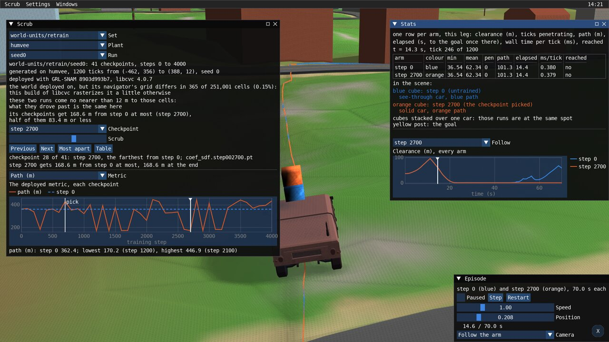
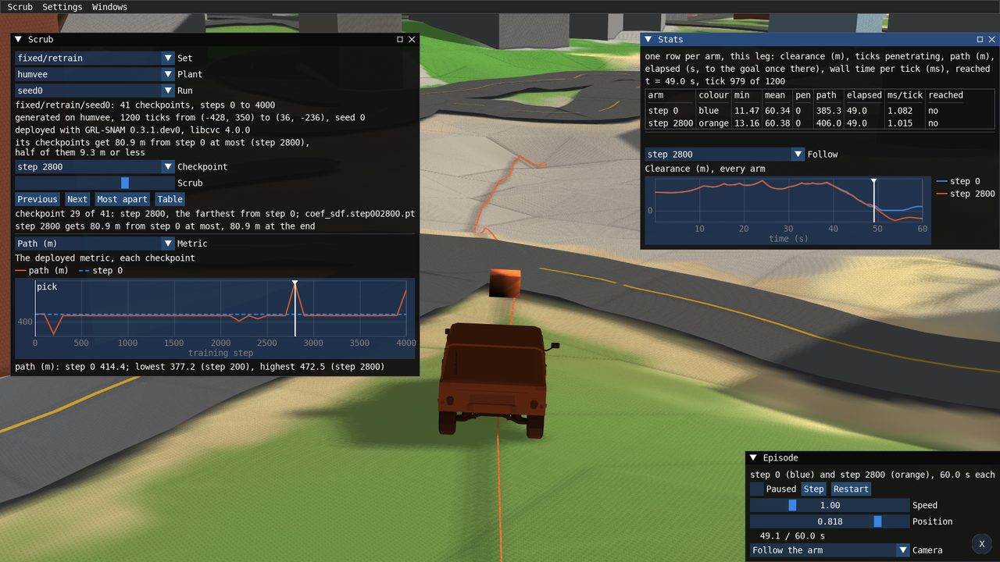
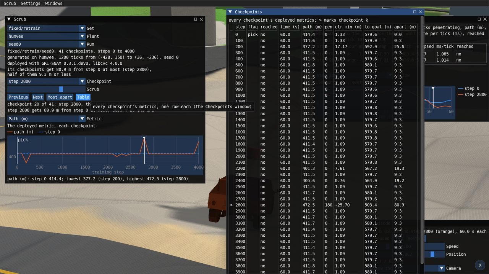
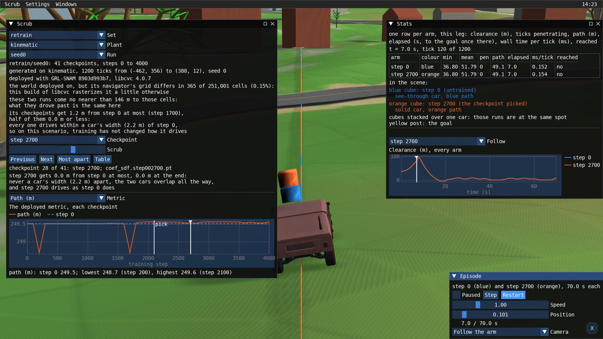

# The checkpoint scrubber: a short guide

`grl-snam ariadne scrub` deploys every checkpoint a training run saved. The Pages site's scrub page
is the same thing in a browser. This guide says what each window shows, and what to look for to
tell a policy that is learning something useful from one that is not.

## What you are looking at

Every checkpoint drives the same scenario: the same world, start, goal, seed, plant and number of
ticks. So any difference between two checkpoints comes from the policy, not from the scene.

- **Two cars.** The orange car is checkpoint k, the one you picked. The blue car is step 0, the
  untrained net, drawn see-through. They drive side by side over the same episode, each with a
  cube of its colour above it and its whole path drawn on the ground. Where the two drive the
  same, the orange car hides the blue one and the paths lie on top of each other: the two cubes
  stacked over one car show both are there. The yellow post is the goal. The Stats window's
  legend ("in the scene") says the same, with each arm's name in its colour.
- **The plant.** The cars drive libcvc's Jolt Humvee by default (`--plant humvee`). The Humvee
  collides with the buildings: a car that drives into one stops against it. The old default,
  nav's kinematic bicycle (`--plant kinematic`), has no collision response, so its cars can drive
  into buildings.

## The windows

- **Scrub** picks what you look at and charts it.
  - *Set* and *Run* pick a data set (a retrain) and a run in it (one training seed).
  - *Checkpoint*, the slider, *Previous* and *Next* pick checkpoint k. *Most apart* picks the
    checkpoint whose car gets farthest from step 0's.
  - Two lines say how far apart the cars drive: the farthest checkpoint k's car gets from step
    0's at the same moment (and at the end), and the same for all the run's checkpoints. When
    that is less than a car's width, the two drive as one, and the lines say so: scrubbing
    through such a run changes nothing you can see, because the checkpoints all drive alike.
  - *Metric* picks the deployed number to chart. The options are reached the goal, time, path
    length, ticks penetrating, minimum and mean clearance, distance left to the goal, and how far
    the car got from step 0's.
  - The chart shows that metric against training step, one point per checkpoint. Step 0's value
    is the dashed line, and the cursor marks checkpoint k. Click a point to pick it.
  - *Table* opens **Checkpoints**: every metric, one row per checkpoint, `>` at checkpoint k.

  | the cars parted (49 s in) | Checkpoints | `retrain` on kinematic: the two drive as one |
  |---|---|---|
  |  |  |  |

- **Training** is the held-out curve the training run logged. *Curve* picks the term. It has the
  same cursor, and a click on it picks the checkpoint nearest that step.
- **Episode** is the play head: *Paused*, *Step* and *Restart*, the *Speed*, the position slider,
  which scrubs through the episode, and *Camera*, which either follows checkpoint k's car or
  orbits the world from above.
- **Stats** has one row per car: clearance (minimum and mean), ticks penetrating, path length,
  time elapsed, wall time per tick, and whether it reached the goal. Below the rows is the
  clearance chart over the episode.
- **Ledger** has one row per car. It shows:
  - the policy's coefficients (`alpha` the wall barrier's gain, `beta` the goal's, `gamma` the
    damping, and the `lam_*` and `mu` heads when the net has them);
  - the potential's terms;
  - the energy books.

  Each comes summed over the run and for this tick.
- **Simulation** pauses, steps and restarts the episode too (the Scrub menu has *Paused*).
- No window has a set size: each grows to fit what it shows, as far as the edge of the view, and
  scrolls past that.

## What converging on useful behaviour looks like

A falling training loss is not enough. Look for all of the following together.

1. **The deployed metric leaves step 0's line, and stays away from it.** Reached flips to yes, time,
   path and distance to the goal fall, and ticks penetrating stays at 0, all compared with the
   dashed line. One good checkpoint proves nothing; a run of them in a row does.
2. **The outcomes are ordered by training step.** Later checkpoints do at least as well as earlier
   ones, and neighbours agree with each other. When the chart jumps between two outcomes from one
   checkpoint to the next, the policy is not settling: that is noise, not learning.
3. **The held-out curve and the deployed metric move together.** In *Training*, the held-out
   curve falls and flattens. At the same steps, the deployed metric in *Scrub* improves. If the
   curve falls while the deployed metric stays flat, the objective is not the task.
4. **Every seed agrees.** Step through *Run*: the same trend should show on every seed of a set,
   not just on the seed you looked at first. *Set* compares retrains at the same step.
5. **The coefficients settle, and they respond to the situation.** In *Ledger*, `alpha`, `beta`
   and `gamma` stop changing between neighbouring checkpoints, and they end up away from step 0's.
   Within an episode they should also vary with where the car is. Coefficients that stay at one
   value all episode mean training only moved the mean, which a constant net would do as well.
6. **The car drives better, not just faster.** The orange car takes a shorter, cleaner route than
   the blue one. It keeps its clearance above 0 in *Stats*' chart, and it does not gain reach by
   scraping walls.

## Warning signs

- **The best checkpoint is step 0:** training never improved on the untrained net.
- **Ticks penetrating above 0, or clearance falling while reach rises:** the policy is trading
  safety for progress. A tick penetrating is a tick with the car's centre on a cell the navigator
  marks blocked, a building or deep water.
- **Outcomes scattered across training steps** instead of ordered by them.
- **A held-out curve that falls while the deployed metric stands still.**

## What today's runs show

The Pages page shows the learning check's three retrains: `retrain`, `fixed/retrain` and
`world-units/retrain`, five seeds each, on libcvc's generated city. A second page beside it,
`scrub-austin/`, shows the same runs deployed in Austin, where the policies were trained; the
numbers below are the generated city's.
[`learning-validation.md`](learning-validation.md) has the full measure. In short:

- Training curves fall in the later retrains.
- Deployed outcomes are not yet ordered by training step, and no set shows criteria 1–6 together.
- No checkpoint reaches the goal on either plant.
- On kinematic, every checkpoint of every set drives the same line into the same small building,
  17 s in, spends 59 or 60 of its 1200 ticks inside it, backs out and stays beside it to the end.
  Every checkpoint drives within 1.2 m of step 0, so the two cars overlap all the way, scrubbing
  through a kinematic set shows nothing, and the Scrub window says so. None of those ticks is on
  water: libcvc 4.0.7 no longer marks the generated city's dry ground as deep water
  (transfix/libcvc#1374).
- On the Humvee no tick penetrates, but every checkpoint touches a building, and 17 of the 615
  roll over. A policy that had learned to route around buildings would not do that.
- On the Humvee the checkpoints part from step 0: half of them get at least 39 m from step 0's
  car in `retrain`, 43 m in `fixed/retrain` and 95 m in `world-units/retrain`. They part with no
  direction to it: in every set some end nearer the goal than step 0 and some farther, whatever
  the training step. The page opens on `world-units/retrain`, whose checkpoints part most, at the
  checkpoint farthest from step 0. `fixed/retrain`'s history picks step 0 on every seed.

So treat the page as the instrument to watch the next retrain with, not as evidence that the
current policy learned. The numbers, per set and plant, are in the scrub section of
[`grl_snam/ariadne/README.md`](../grl_snam/ariadne/README.md).
